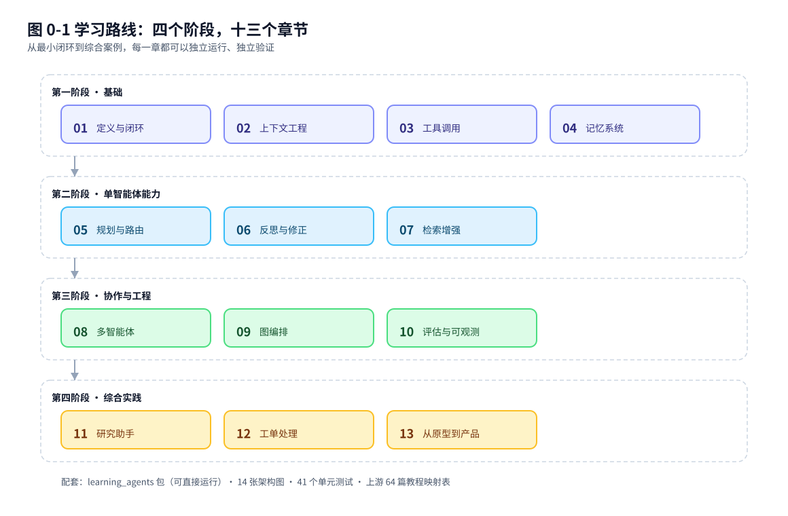

# Learning_AI_Agents

一个偏探讨性质的中文智能体工程笔记库：13 章正文、14 张架构图、一个零依赖实现、42 个单元测试。它不讨论智能体能做什么，讨论为什么这样设计、代价是什么、失败长什么样。



## 这是什么

正文把智能体拆成十三个可以独立验证的问题，从最小闭环到多智能体与生产化，按能力层重组为四个阶段。每章给出一个可运行的最小实现、一张说明数据流与控制流的图、一组工程判据，以及一条判断改动好坏的方法。

代码在 `learning_agents/` 里，只依赖 Python 标准库，不需要 API Key。运行 `python -m learning_agents.demo` 可以看到十种控制流的完整轨迹，包括工具调用、错误回灌、审批拒绝和循环终止。插图由 `diagrams/` 下的脚本生成，改布局只需要改坐标，不用重画。

## 这不是什么

它与上游仓库没有代码或文字的复用关系，两者的分工见[第 00 章](docs/00-preface.md)与[附录 B](docs/B-upstream-map.md)。示例刻意不依赖 LangGraph 或 AutoGen，目的是先看清机制，再决定换不换框架；因此本库不涉及某个框架的最佳实践。提示词也不是重点，它只是上下文工程的一部分，其余部分在第 02 章。

## 快速开始

```bash
cd Learning_AI_Agents

python -m learning_agents.demo            # 10 个场景，离线可跑
python -m learning_agents.demo rag plan   # 只跑指定场景
python -m unittest discover -s tests      # 42 个测试
python build.py                           # 生成 book.html（插图内联）
```

`demo basic` 的真实输出如下。

```text
agent.start   {"task": "请帮我计算 (128*7+36)/4 的结果", "tools": 1}
agent.step    {"step": 1, "tokens": 199}
llm.response  {"step": 1, "tool_calls": ["calculator"]}
┌─ tools
  │  tool.call: calculator {"ok": true, "duration_ms": 0.06}
└─ end tools (0.0ms)
agent.step    {"step": 2, "tokens": 245}
llm.response  {"step": 2, "tool_calls": []}
agent.end     {"stopped": "final", "steps": 2, "tokens": 524}
```

接入真实模型需要三个环境变量，`OPENAI_BASE_URL` 与 `OPENAI_MODEL` 可以省略，默认指向官方地址与 `gpt-4o-mini`。

```bash
export OPENAI_API_KEY=...        # Windows: $env:OPENAI_API_KEY="..."
export OPENAI_BASE_URL=https://api.openai.com/v1
export OPENAI_MODEL=gpt-4o-mini
```

## 目录

| 阶段 | 章节 | 一句话看点 |
|---|---|---|
| 导论 | [00 为什么从零写一遍](docs/00-preface.md) | 三类材料之间的缝，以及本库怎么补 |
| 一 · 基础 | [01 定义与最小闭环](docs/01-agent-loop.md) | 四档自主度、四条终止条件、平方级成本 |
| | [02 上下文工程](docs/02-context.md) | 预算表、四种压缩、位置效应 |
| | [03 工具调用](docs/03-tools.md) | schema 四原则、错误分类、幂等与审批 |
| | [04 记忆系统](docs/04-memory.md) | 三层记忆、写入阈值、冲突与遗忘 |
| 二 · 单智能体 | [05 规划与路由](docs/05-planning.md) | 一张判定图、计划质量标准、重规划上限 |
| | [06 反思与修正](docs/06-reflection.md) | 三种反馈源、三条终止条件、自愈代码 |
| | [07 检索增强](docs/07-rag.md) | 切分参数、RRF、引用覆盖率 |
| 三 · 协作与工程 | [08 多智能体](docs/08-multiagent.md) | 三条判据、四种拓扑、成本乘数 |
| | [09 图编排](docs/09-orchestration.md) | 状态三原则、检查点、HITL 语义 |
| | [10 评估与可观测](docs/10-evaluation.md) | 三层评估、用例来源、发布门禁 |
| 四 · 实践 | [11 案例：研究助手](docs/11-case-research.md) | 并行取证、证据表、强制引用 |
| | [12 案例：工单处理](docs/12-case-ticket.md) | 路由、规则、审批与灰度 |
| | [13 从原型到产品](docs/13-production.md) | 十二条清单、反模式、发布流程 |
| 附录 | [A 术语表](docs/A-glossary.md) · [B 上游 65 篇映射](docs/B-upstream-map.md) · [C 参考与许可](docs/C-references.md) | |

全部插图在 `diagrams/out/` 下，共 14 张，同时提供 SVG 与 PNG。单页版本是 `book.html`，由 `build.py` 生成，插图内联在页面里，双击即可阅读。

## 写作原则

做法上有一条主线：机制优先于框架。先用一百多行看清循环、工具、记忆，再看框架替你做了什么，否则只是把不理解的东西交给别人封装。配套的判断是错误即数据，工具失败不抛异常，而是回灌成观察，循环因此能自我修正。

工程上先写边界再写能力。终止条件、预算、审批门放在功能之前，因为缺了它们，原型只能演示不能上线。每个结论都应当对应一条可运行的断言或一段可复现的输出，做不到就说明还没想清楚。

文字部分按 `research-writing` 技能的中文学术行文规范维护，规范本身见 [CONTRIBUTING.md](CONTRIBUTING.md)。引用他人观点一律给链接，不搬运代码与文字，具体说明见[附录 C](docs/C-references.md)。

## 仓库结构

```text
Learning_AI_Agents/
├── README.md
├── book.html                  # 单页合集（生成物）
├── build.py                   # 生成 book.html
├── docs/                      # 13 章 + 3 附录
├── learning_agents/           # 零依赖实现
│   ├── agent.py  llm.py  tools.py  trace.py
│   ├── memory.py rag.py planning.py reflection.py
│   ├── multiagent.py evaluation.py guardrails.py
│   └── demo.py                # 10 个可运行场景
├── examples/                  # 6 个独立示例
├── diagrams/
│   ├── scene.py               # 一份布局 → SVG + PNG
│   ├── figures_core.py  figures_ext.py
│   ├── build_diagrams.py
│   └── out/                   # 14 张 svg + png
├── data/corpus/               # 示例语料（原创）
├── tools/                     # 链接检查、文风审计
└── tests/                     # 42 个单元测试
```

## 许可

代码采用 MIT 许可，见 [LICENSE](LICENSE)。文档与插图采用 CC BY 4.0，见[附录 C](docs/C-references.md)。
