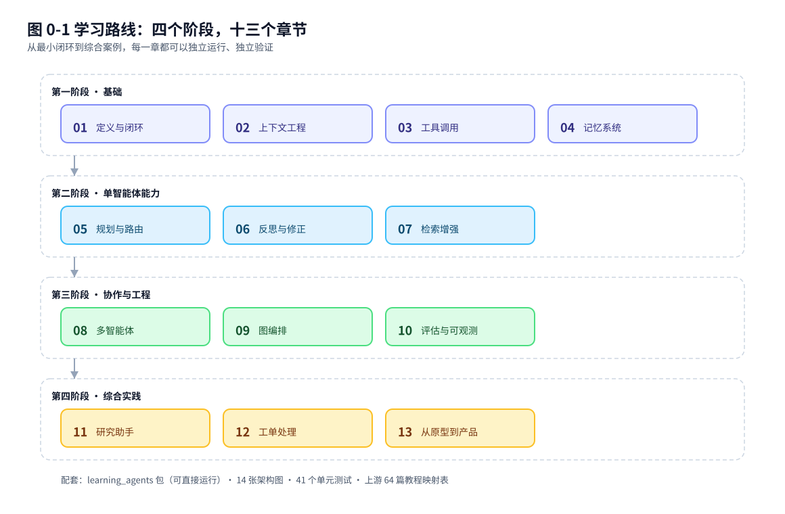

# 00 · 导论：为什么值得从零写一遍

> 智能体是一种工程结构：把模型放进循环，再给循环装上边界。模型本身没有变，变的是它被放在什么位置。理解了这层结构，框架选型、成本控制和可靠性治理会变成同一道题的三种问法。

## 这个库解决什么问题

围绕智能体的材料大致分三类。论文给出概念，很少给工程细节；框架文档给出接口，很少解释为什么这样设计；教程给出可运行的 notebook，但代码量与概念量往往同时膨胀。三者之间有一条缝：使用者能跑通示例，却说不清自己在做什么取舍。

本库试图补上这条缝：把"做一个能用的智能体"拆成十三个可以独立验证的问题，每个问题给出一个可运行的最小实现、一张说明数据流与控制流的图、一组工程判据，以及一条判断改动好坏的方法。实现放在 `learning_agents` 包里，只依赖 Python 标准库，不需要 API Key 就能跑通全部示例。

## 与上游仓库的关系

本库的选题结构参考了开源教程集 NirDiamant/GenAI_Agents，该仓库收录 65 篇 notebook，覆盖对话、记忆、多智能体、评估与行业应用。参考的是选题范围与术语体系，不是内容本身。

| 维度 | 上游 GenAI_Agents | 本库 Learning_AI_Agents |
|---|---|---|
| 载体 | Jupyter notebook | Markdown 章节、Python 包、单页 HTML |
| 组织 | 按教程逐篇排列 | 按能力层重组为四阶段十三章 |
| 代码 | 依赖 LangGraph、AutoGen 与各家 SDK | 纯标准库，先看清机制再换框架 |
| 图 | 各 notebook 内嵌截图 | 14 张统一风格、可重新生成的矢量图 |
| 目标 | 展示能做什么 | 解释为什么这样做、代价是什么 |

上游的 65 篇教程按主题映射到本库的章节，见[附录 B](B-upstream-map.md)。这里没有复用它的代码、文字、图片或数据，`learning_agents` 的实现与全部插图都是独立编写的。上游采用自定义的非商业许可，如果计划商业使用其材料，需要先阅读它的 `LICENSE`。

## 整体结构

*图 0-1　四个阶段的能力是叠加的。没有 01 至 04 章的闭环与工具，05 至 07 章的规划与检索就没有落点；没有第 10 章的评估，08 与 09 章的协作和编排无法判断是否值得。*

前四章建立最小闭环，覆盖循环、上下文、工具与记忆。第 05 到 07 章给单个智能体加能力，讲规划、反思与检索。第 08 到 10 章处理规模与工程，涉及多智能体、图编排、评估与可观测。第 11 到 13 章是两个完整案例，以及从原型到产品的清单。

## 阅读方式

只有两小时，读 01、03、10 三章，运行 `python -m learning_agents.demo basic react eval`。做完会得到一条能跑、能看轨迹、能被断言的最小链路。

要做一个内部工具，读 01 到 05 章，加第 10 章和第 12 章。工单类场景的确定性收益最高，先做路由，再考虑自主循环。

要评审别人的方案，先看第 13 章的反模式清单，再回到对应章节核对取舍。

## 约定

代码块中的省略号表示节选，完整实现见仓库同名文件。token 指模型计费单位，步指一次模型调用及其触发的工具执行。示例默认离线运行，接入真实模型需要设置 `OPENAI_API_KEY`、`OPENAI_BASE_URL` 和 `OPENAI_MODEL`，具体做法见[第 01 章](01-agent-loop.md)末节。

文中的预算、阈值、轮数都是起点，不是结论，需要按自己的评估集重新标定。凡标注为经验值的地方，都给出了得出它的条件；条件变了，数值也要跟着变。

## 参考

- Yao et al., *ReAct: Synergizing Reasoning and Acting in Language Models*, 2022.
- Schick et al., *Toolformer*, 2023.
- Lewis et al., *Retrieval-Augmented Generation for Knowledge-Intensive NLP Tasks*, 2020.
- Shinn et al., *Reflexion: Language Agents with Verbal Reinforcement Learning*, 2023.
- NirDiamant, *GenAI_Agents*（开源教程集），<https://github.com/NirDiamant/GenAI_Agents>.
