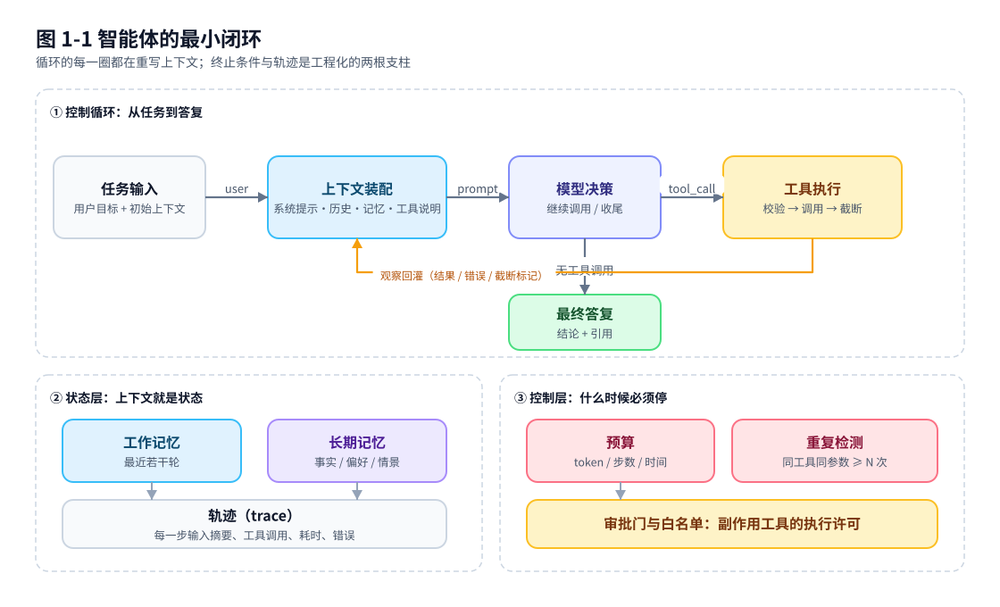

# 01 · 智能体的定义与最小闭环

> 判断一个系统是不是智能体，看两件事：控制流由谁决定，能不能读到自己上一步的结果。模型多大不参与这个判断。

## 学习目标

读完本章，应当能够用四个要素判断一个系统属于哪一档自主度，写出一个不依赖框架、可以被单元测试覆盖的循环，说明循环成本为什么随步数呈平方增长，并为循环接上可回放的轨迹。

## 1.1 三个必要条件

工程上判断一个系统是否为智能体，通常看三条是否同时成立：目标以自然语言给出，而不是以固定参数给出；行动通过工具作用于外部世界，例如检索、读写文件、调用接口；下一步依赖上一步的观察，也就是存在反馈回路。只满足前两条的系统更接近带工具的单次调用，只满足第一条和第三条的系统通常叫多轮对话，三条齐备才构成循环。这个区分有实际用途，因为三条各自对应一类失败模式，缺哪一条就少一类防护。

由此可以排出四档自主度，成本与风险自上而下递增。固定工作流的控制流由人写死，适合步骤稳定、可以枚举的场景；路由由代码或分类器决定分支，适合意图可分类、分支有限的任务；单智能体的循环由模型决定下一步，适合工具充分、路径不确定的任务；多智能体再由模型在角色之间协调，适合角色确实异质、任务足够长的情况。选择顺序应当是前两档优先，因为它们的失败可以复现、可以断言，而自主循环的失败往往只能靠轨迹事后归因。

| 档位 | 控制流由谁决定 | 典型形态 | 适用条件 |
|---|---|---|---|
| L0 | 人写死 | 固定工作流（DAG） | 步骤稳定、可枚举 |
| L1 | 代码加分类器 | 路由到不同模板 | 意图可分类，分支有限 |
| L2 | 模型加循环 | ReAct 单智能体 | 工具充分、路径不确定 |
| L3 | 模型加多角色 | 主管、辩论、黑板 | 角色确实异质、任务足够长 |

## 1.2 循环的四个组件



*图 1-1　控制循环（上）与它依赖的状态层、控制层（下）。循环本身只有十几行，复杂度全部来自两侧的支撑。*

模型负责在候选动作中做选择，工具负责把选择变成对世界的作用，状态负责记住做过什么、看到了什么，边界负责决定何时停下。任一处缺失，症状都很明确：没有工具，模型只能描述而不能执行；没有状态，每一轮都从零开始，重复劳动；没有边界，循环可能在两句客套话之间来回。

一个可以直接运行的骨架如下，完整实现见 `learning_agents/agent.py`。

```python
messages = [system_prompt, user_task]
for step in range(max_steps):
    if budget.exceeded(usage):
        return stop("budget")
    resp = llm.complete(messages, tools=registry.schemas())
    if not resp.tool_calls:
        return answer(resp.text)          # 模型主动收尾
    messages.append(assistant_message(resp))
    for call in resp.tool_calls:
        result = registry.execute(call)   # 永不抛异常：错误也是结果
        messages.append(result.to_message())
return stop("max_steps")
```

这段代码有三个细节决定了它能否上生产。`registry.execute` 不抛异常，而是返回结构化结果，错误作为观察回灌，模型才有机会换参数、换工具或者承认失败。每一轮把 `tool_calls` 与 `tool` 消息成对写回，顺序与 id 必须匹配，否则模型会把两条观察对错号。预算在调用模型之前检查，而不是之后，先花钱再判断等于没有预算。

## 1.3 成本为什么是平方级

设第 $i$ 步的上下文为 $S_i$，每步新增的观察与决策为 $\Delta$，则第 $i$ 步的上下文约为 $S_0 + i\Delta$，$n$ 步的总消耗为

$$
T(n)=\sum_{i=1}^{n} S_i \approx nS_0 + \frac{n(n-1)}{2}\Delta .
$$

步数翻倍，总 token 大约翻四倍。两个经验值由此而来。单智能体的步数上限通常设在 4 到 10 步之间，超过 10 步的任务更适合拆成子任务或者改成显式计划；把每步的新增内容 $\Delta$ 压掉一半，总成本降幅接近一半，而且越到后面的步数省得越多。这也解释了为什么上下文压缩在长任务里的收益被放大。

## 1.4 终止条件

| 条件 | 触发 | 防的是什么 | 建议值 |
|---|---|---|---|
| `final` | 模型不再请求工具 | 正常收尾 | — |
| `max_steps` | 达到步数上限 | 思考过久、路径发散 | 4 至 10 |
| `budget_tokens` | 累计 token 超限 | 成本失控 | 单任务 2 万至 10 万 |
| `loop_detected` | 同工具同参数连续 N 次 | 原地打转 | N 取 2 至 3 |

四类条件覆盖的失效模式互不重叠。前两类防想太久，后两类防绕圈子。只设 `max_steps` 的系统在长上下文里依然可能烧掉十倍预算，只设预算的系统则可能第三步就把额度花光，交回一个半成品答复。工程上还应记录停下的原因，`stopped_reason` 是评估和告警的第一字段。某一周内 `max_steps` 的比例突然升高，通常意味着工具描述或者提示词发生了回归。

## 1.5 轨迹

`learning_agents/trace.py` 把每个动作落成事件，按行追加写入 JSONL。一次两步的运行为：

```text
agent.start   {"task": "请帮我计算 (128*7+36)/4 的结果", "tools": 1}
agent.step    {"step": 1, "tokens": 199}
llm.response  {"step": 1, "tool_calls": ["calculator"], "tokens": 211}
┌─ tools {"names": ["calculator"]}
  │  tool.call: calculator {"ok": true, "duration_ms": 0.06}
└─ end tools (0.0ms)
agent.step    {"step": 2, "tokens": 245}
llm.response  {"step": 2, "tool_calls": [], "tokens": 313}
agent.end     {"stopped": "final", "steps": 2, "tokens": 524}
```

事件类型只有六种，却足以回答排障中最常见的四个问题：调用了哪个工具，参数是什么，花了多少 token，在哪一步停下。第 10 章会把这份轨迹变成可以断言的评估输入。

## 1.6 接入真实模型

离线示例使用 `RuleBasedLLM`，作用是让控制流可见，不代表真实模型的能力边界。切换到兼容 OpenAI 协议的服务只需改一行。

```python
from learning_agents.llm import OpenAICompatLLM
from learning_agents.agent import Agent

agent = Agent(llm=OpenAICompatLLM(model="gpt-4o-mini"), tools=registry)
result = agent.run("把这周的销售数据汇总成三条结论")
```

需要的环境变量是 `OPENAI_API_KEY`、`OPENAI_BASE_URL` 与 `OPENAI_MODEL`，其中后两个可以省略。客户端只依赖标准库，超时与重试次数显式可配；`429` 与 `5xx` 才重试，其余 4xx 直接失败。把不可重试的错误重试三次，只会把延迟放大三倍，并不会提高成功率。

## 工程要点

先把终止条件写出来，再写循环体。顺序反过来的项目，通常能跑但不能停，只能靠外层超时兜底。

状态要可序列化。循环里不要长期持有数据库连接、文件句柄、线程锁，第 09 章的检查点依赖这一点。业务规则中的硬约束，例如权限、金额上限、输出格式，应当放在代码里校验，只有风格和取舍留给提示词。

一次只加一个自由度。先加工具，再加记忆，再考虑多智能体，每加一层重跑一遍评估集。同时增加两个能力而未分别度量，一旦指标下降就无法判断是哪一层造成的。

## 常见失败模式

| 失败 | 表现 | 改法 |
|---|---|---|
| 提示词膨胀 | system prompt 从 200 字涨到 3000 字，关键约束被稀释 | 硬规则进代码，软风格进提示 |
| 静默截断 | 工具输出被截断却没有标记，结论建立在残缺事实上 | 截断处显式标注 |
| 错误吞掉 | `try/except: pass` 让循环看起来跑完，其实每步都失败 | 错误必须成为观察 |
| 只打印不落盘 | 日志无法聚合、无法回放、无法评估 | 事件写入 JSONL |

## 练习

1. 把 `max_steps` 改为 3，观察 `demo_react` 的 `stopped_reason` 与答案质量的对应关系。
2. 给 `Agent` 增加 `max_tool_calls` 计数，超限时返回 `stopped_reason="budget_tools"`，并补一条单元测试。
3. 用脚本模型构造一个工具总是超时的场景，验证循环以 `final` 结束且答案明确说明失败，而不是以异常结束。

## 参考

- Yao et al., *ReAct: Synergizing Reasoning and Acting in Language Models*, 2022. <https://arxiv.org/abs/2210.03629>
- Anthropic, *Building effective agents*, 2024. <https://www.anthropic.com/research/building-effective-agents>
- 代码：`learning_agents/agent.py`、`learning_agents/trace.py`、`learning_agents/demo.py`
