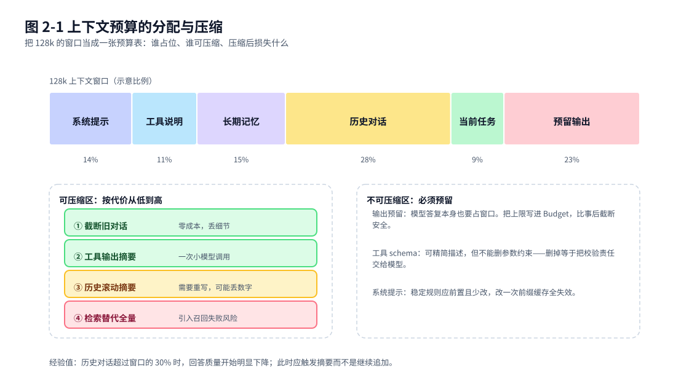

# 02 · 上下文工程：把提示词当程序写

> 模型的"记忆"只有上下文窗口。上下文工程是在有限窗口里做预算分配与信息压缩，让每一步决策拿到恰好够用的信息。

## 学习目标

读完本章，应当能够拆解一次请求的上下文构成并给出预算表，在四种压缩策略之间按信息损失与成本排序，理解位置效应与缓存命中对提示结构的要求，并用结构化输出把自然语言约定换成可校验的契约。

## 2.1 上下文是唯一的编程接口

传统程序通过函数签名传参，智能体通过上下文传参。角色、权限、格式、可用工具、历史事实都要挤进同一段文本，争夺同一个预算。由此得出一个不太直观的结论：提示词写得好不好，主要不取决于措辞，而取决于信息的选择与排序。同一批信息，把当前任务放在三千字历史之后，模型对它的关注度会明显下降，这类现象通常称为 lost in the middle。



*图 2-1　把窗口当预算表：先分配，再压缩。右侧三类内容不可压缩，必须预留。*

## 2.2 预算表

设窗口为 $B$，一次请求由六部分组成：系统提示 $S$、工具 schema $T$、长期记忆或检索结果 $M$、历史对话 $H$、当前任务 $Q$、输出预留 $O$，满足 $B \ge S+T+M+H+Q+O$。

| 部分 | 含义 | 常见占比 | 可否压缩 |
|---|---|---|---|
| $S$ | 角色、规则、风格 | 10% 至 15% | 可精简，不可删约束 |
| $T$ | 工具 schema | 8% 至 15% | 可精简描述 |
| $M$ | 长期记忆、检索结果 | 10% 至 25% | 可换更少更准的片段 |
| $H$ | 历史对话 | 20% 至 40% | 可摘要、可截断 |
| $Q$ | 当前任务 | 5% 至 10% | 不可压缩 |
| $O$ | 输出预留 | 15% 至 25% | 不可压缩 |

输出预留最容易被忽略。模型生成的答复同样占用窗口，思维链越长占用越多。把输出上限写进预算，比事后截断安全，因为截断会把一句结论切成半句，而模型并不知道自己被切了。一个可用的起点是历史不超过 30%，检索不超过 25%，输出预留 20%；历史突破 30% 之后，回答质量的下降通常已经可以测出来。

## 2.3 四种压缩策略

| 策略 | 做法 | 信息损失 | 额外成本 | 适用 |
|---|---|---|---|---|
| 截断 | 丢弃最早的对话 | 高，会丢约束和数字 | 无 | 短会话、闲聊 |
| 工具输出摘要 | 大结果先摘要再回灌 | 中 | 一次小模型调用 | 日志、长文档 |
| 滚动摘要 | 把旧对话压成事实清单 | 中高 | 周期性调用 | 长会话、客服 |
| 检索替代 | 历史入索引，按需召回 | 低，但可能召回失败 | 建索引与检索 | 跨天、跨会话 |

选择原则是按代价从低到高试，而不是按效果从好到坏选。截断零成本，先看够不够用；确认丢了关键信息，再升级到摘要。反过来，一上来就做全量检索，会把一个两百毫秒的请求拖到两秒，还引入召回失败这个新的故障点。

有一条经验容易被忽略：数字与人名不要进摘要。摘要模型倾向于把"3.2%""订单号 20241105"这类细节抹平，而后续步骤要用它们。稳妥做法是把结构化事实单独存一份键值，摘要只压叙述性内容。

## 2.4 消息结构与位置效应

一条稳定的消息序列通常是这样排列的：系统消息给出角色与硬规则；另一条系统消息放参考事实，并带来源编号；用户消息给出当前任务、示例与验收标准；中间是循环产生的历史；末尾是本轮追问。

```text
[system] 角色 + 硬规则 + 输出格式
[system] 参考事实（检索/记忆，带来源编号）
[user]   当前任务（含示例与验收标准）
[assistant/tool] ... 循环产生的历史 ...
[user]   本轮追问（如有）
```

这套顺序对应三条经验。硬规则前置且少改，前缀稳定才能吃到前缀缓存的折扣，每改一次系统提示，缓存全量失效。参考资料与任务分开，混在一条消息里，模型容易把资料里的说法当成用户的要求。示例紧跟任务，放在最前面会被后续内容稀释。

## 2.5 结构化输出

自然语言约定在压力下会失效：模型可能加解释、加 markdown 代码块、少字段。可行做法是三层防御。

```python
raw = llm.complete(prompt, response_format={"type": "json_object"}).text
data = validate_json(raw, {
    "required": ["intent", "confidence"],
    "properties": {
        "intent": {"type": "string", "enum": ["refund", "invoice", "other"]},
        "confidence": {"type": "number"},
    },
})
```

请求侧声明格式，解析侧容忍代码围栏与尾逗号，schema 层做最终校验。第三层最重要，因为它把"模型是否听话"变成了"系统是否接受"。失败时把错误信息回灌让模型重试一次，仍然失败就走降级分支。没有校验的结构化输出，只是看起来像结构化的文本。

## 2.6 装配的实现

`learning_agents/memory.py` 里的 `MemoryManager.build_context` 把三层记忆拼成一段带标签的文本。

```python
manager.observe("user", "我们上季度的退货率是多少？")
manager.remember("门店 A 的退货率连续两季高于均值", importance=0.8)
context = manager.build_context("退货率 门店 A 的对比", k=2)
```

输出形如：

```text
[长期事实]
- (2026-08-22) 门店 A 的退货率连续两季高于均值

[相似任务]
- 统计上季度退货率 => 退货率 3.2%，低于阈值 5%

[近期对话]
user: 我们上季度的退货率是多少？
assistant: 3.2%，来源：订单表按月聚合。
```

标签不是装饰。它让模型知道每段信息的可信度与时效，从而在冲突时优先采用近期对话，而不是半年前的事实。日期同理，写进括号里比让模型自己推断"这条是不是过时"要可靠。

## 工程要点

预算先于内容。先算 $S+T+M+H+Q+O$，再决定放什么；反过来一定超。每次压缩都要记录压缩前 token、压缩后 token 与被丢弃的内容，否则质量下降无法归因。提示词要进版本库，有 diff、有评审、有回归测试。

用户输入不要拼进系统提示。这是提示注入的入口。用户内容一律放在 user 消息里，并明确标注来源，让模型知道哪些是资料、哪些是指令。

## 常见失败模式

约束失效时不断追加措辞，是提示膨胀的起点。正确的做法是把约束移进代码校验，提示里只保留无法用代码判断的部分。

滚动摘要之后模型开始编造金额与日期，多半是摘要吃掉了数字。检索结果塞进八个片段而真正相关的只有一个，模型会被噪音带偏，宁少勿多，top-3 通常优于 top-8。

系统提示里塞时间戳或随机 ID，会让每次请求的前缀都不同，缓存全部失效。这类问题不体现在正确率上，只体现在账单上。

## 练习

1. 用 `estimate_tokens` 统计 `demo_rag` 中 context 的占比，把它压到 25% 以内，观察答案是否变差。
2. 写一个 `ContextBudget` 类：给定各段文本与预算，按优先级截断，并返回被丢弃的段落清单。
3. 给 `validate_json` 增加数组元素类型校验，并为"多返回一个字段"设计策略，说明选择拒绝还是忽略的理由。

## 参考

- Liu et al., *Lost in the Middle: How Language Models Use Long Contexts*, 2023. <https://arxiv.org/abs/2307.03172>
- Anthropic, *Prompt caching* 文档，前缀缓存的工作原理。
- 代码：`learning_agents/llm.py` 中的 `estimate_tokens`，`learning_agents/guardrails.py` 中的 `validate_json`
