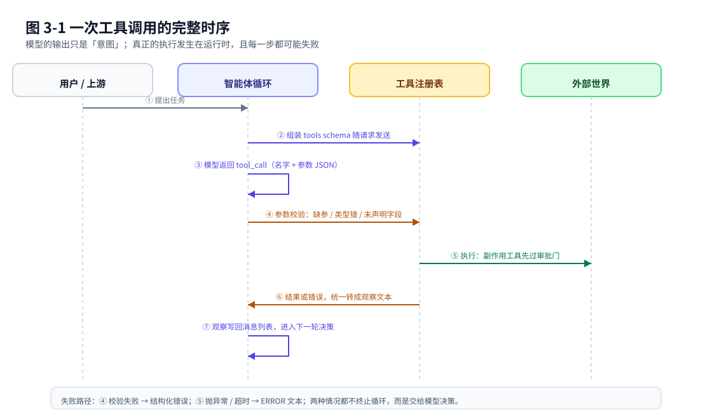

# 03 · 工具调用：模型唯一的"手"

> 模型看不到你的代码，只能看到工具的名字、描述与参数 schema。这三样东西合起来就是全部的用户界面，写得含糊，等于让模型蒙着眼睛操作。

## 学习目标

读完本章，应当能够用四条原则设计工具 schema，并说清每条原则对应的失败模式；能讲出一次工具调用在运行时的完整时序，以及每一步的错误处理；能为副作用工具设计幂等键与审批门；能区分可重试错误与应上报错误，并让模型在文本里看见这个区别。

## 3.1 工具是接口，不是函数包装

把业务函数直接暴露给模型，是常见的第一个错误。函数签名面向程序员，可以传对象，可以抛异常；工具 schema 面向概率模型，只能填 JSON，只能读文本返回。两套契约的差异需要显式处理，否则代码侧的类型约束到了模型侧完全不存在。

| 面向 | 函数 | 工具 |
|---|---|---|
| 参数 | 任意类型、可选依赖注入 | 扁平 JSON，字段越少越好 |
| 返回 | 对象 / 异常 | 文本（或可序列化的结构） |
| 失败 | 抛异常由上层捕获 | 返回结构化错误，交给模型决策 |
| 语义 | 调用方知道上下文 | 模型只读描述，必须自解释 |

## 3.2 schema 设计的四条原则

第一条是动词开头、语义单一。`get_order_status` 优于 `order`，`search_docs` 优于 `docs`。一个工具只做一件事，模型才可能选对；`manage_order` 这类"万能工具"会让模型在参数里做二次决策，错误率显著上升。第二条是描述要写"何时用"，不能只写"做什么"。

```python
@tool
def lookup_faq(topic: str) -> str:
    """查询内部知识库中的常见问题，topic: 主题关键词

    仅在用户询问政策、流程、时效时使用；不要用于查询具体订单状态。
    """
```

上面这段描述里，第二段话比第一段更重要，因为它排除了一种误用。工具描述里写清"不用于什么"，往往比写"用于什么"更能降低误调用率。第三条是参数少而必要，超过五个参数通常意味着该拆，可选参数要么给默认值并写进 schema，要么删掉，模型对"可选"的理解极不稳定。第四条是返回可控，固定上限默认 4000 字符，超出即截断并显式标注 `…[输出已截断]`。一个返回两万行日志的工具会瞬间吃掉上下文预算，还会稀释真正重要的信息。

工具声明中的 `side_effect` 与 `idempotent` 属于控制点，不能当注释看：

```python
@tool(side_effect=True, idempotent=False)
def send_notice(channel: str, message: str) -> str:
    """向指定渠道发送通知（有副作用，需要人工审批）"""
```

审批门、审计日志、灰度开关都挂在这两个字段上。

## 3.3 一次调用的完整时序



*图 3-1　模型的输出只是一份意图，执行发生在运行时。④ 与 ⑤ 是两道最容易漏掉的闸门。*

参数校验必须放在执行之前，缺参、类型不符、出现未声明字段都应返回结构化错误，静默忽略会让模型以为调用成功，进而在错误前提上继续推理。结果与错误则走同一条通道回灌，都用 `role="tool"` 的消息，模型才能在同一种语义下比较成功与失败。这两点对应图上的 ④ 与 ⑤，跳过任何一道，错误都会以"成功"的形态进入下一轮。

## 3.4 错误分类：让模型知道该不该重试

把错误分成四类，并让文本本身携带可行动信息：

| 类别 | 例子 | 模型应做的动作 | 文本前缀建议 |
|---|---|---|---|
| 参数错误 | 缺必填、类型不符 | 修正参数后重试一次 | `INVALID_ARGUMENT:` |
| 瞬时故障 | 超时、429、连接重置 | 退避后重试，或换工具 | `RETRYABLE:` |
| 永久故障 | 404、权限不足 | 换路径或上报 | `PERMANENT:` |
| 业务拒绝 | 审批未通过、额度不足 | 停止并解释 | `DENIED:` |

不加前缀时，模型面对一段 `Traceback` 往往选择再试一次同样的调用，因为它无法区分参数写错与服务抖动。加了前缀，重试行为会立刻变得合理：`RETRYABLE:` 的先退避再重试，或者换工具；`PERMANENT:` 的换路径或上报；`DENIED:` 的停止并解释。

## 3.5 幂等与审批

副作用工具需要三件东西：幂等键、审批门与审计日志。幂等键取 `idempotency_key(tool, arguments)` 的哈希，同一请求重复到达时直接返回首次结果，避免再发一次货。审批门 `ApprovalGate` 默认拒绝，默认值取"不做"，因为安全的默认值只能落在"不执行"这一侧。审计日志记下谁在什么时候批准了什么参数，它既是合规证据，也是复盘材料。

```python
registry.hook = ApprovalGate(approver=lambda req: "退款" in str(req.arguments)).hook
```

被拒绝时，工具返回 `ERROR: ApprovalDenied`，循环继续，模型据此改写策略或直接说明需要人工处理。审批失败不中断整个任务，它只是又一个观察。

## 3.6 并行调用与顺序回填

模型一次可能返回多个 `tool_calls`。并行执行能把三段串行 300ms 压成 300ms，但有两条约束：副作用工具不得并行，否则幂等键与审批顺序都会失效；结果必须按请求顺序回填，`tool_call_id` 一一对应，顺序错位会让模型把 A 的结果当成 B 的。

`learning_agents/tools.py` 的 `parallel_execute` 用线程池实现，并保持输入顺序：

```python
calls = [ToolCall("1", "add", {"a": 1, "b": 2}), ToolCall("2", "boom", {"text": "x"})]
results = parallel_execute(registry, calls)   # 顺序与 calls 一致
```

## 3.7 协议：MCP 解决了什么

模型上下文协议（Model Context Protocol）把"工具如何被描述与调用"标准化为客户端—服务器结构：主机（Host，如 IDE 或桌面应用）持有模型与用户授权，客户端连接一个或多个服务器，服务器暴露 tools / resources / prompts。它解决的是复用与授权这类问题：同一个数据库工具，不必为每个框架重写一遍适配层；权限与授权在主机侧统一管理，不必散落在每个工具实现里；工具的 schema 与实现可以独立演进、独立部署。

对本库的实现而言，MCP 的价值是把第 3.2 节的四条原则固化成协议字段：`name`、`description`、`inputSchema` 强制存在，服务器能力在握手时声明。自己实现一个最小 MCP 服务器只需百来行，但工具不到三个时不要引入它，协议层的抽象成本只有在工具数量增长之后才会被摊薄。

## 工程要点

工具名与描述是产品文案，值得像 API 文档一样评审。所有工具都应有超时，没有超时的工具会拖垮整个循环。返回结果优先用结构化数据，`{"status": "shipped", "eta": "2024-11-08"}` 比"您的包裹已发出，预计 11 月 8 日到达"更容易被后续步骤使用。

工具数量控制在 10—20 个。超过这个量级，模型的选择准确率会下降，应当考虑按领域分组路由（第 05 章），让一次决策只看一组工具。

## 常见失败模式

描述与实现不一致是最难查的一类问题：文档说返回最近 7 天，代码返回 30 天，模型会基于描述做推理，错误被放大到下游。静默修正参数同样危险，工具内部把 `"3"` 转成 `3` 却不告诉模型，下次模型仍然传字符串，问题被掩盖。错误信息泄露内部细节，把完整 SQL、堆栈、内网地址回灌给模型，既污染上下文，也可能被写进最终答复。工具太多则从另一头出问题：20 个工具、每个描述三行，光是 schema 就占掉 15% 预算，选择准确率同时下降。

## 练习

1. 给 `calculator` 增加除零错误处理，返回 `INVALID_ARGUMENT:` 前缀，并在脚本模型里演示"模型看到错误后改参数"。
2. 实现一个 `with_retry(tool, max_attempts=2)` 包装器：仅对 `RETRYABLE:` 前缀重试，其余直接返回。
3. 统计 `registry.schemas()` 的字符数，把它压到 1200 字符以内，观察工具选择是否仍然正确。

## 参考

- Schick et al., *Toolformer*, 2023. <https://arxiv.org/abs/2302.04761>
- Anthropic, *Model Context Protocol* 规范. <https://modelcontextprotocol.io>
- 代码：`learning_agents/tools.py`、`learning_agents/guardrails.py`
