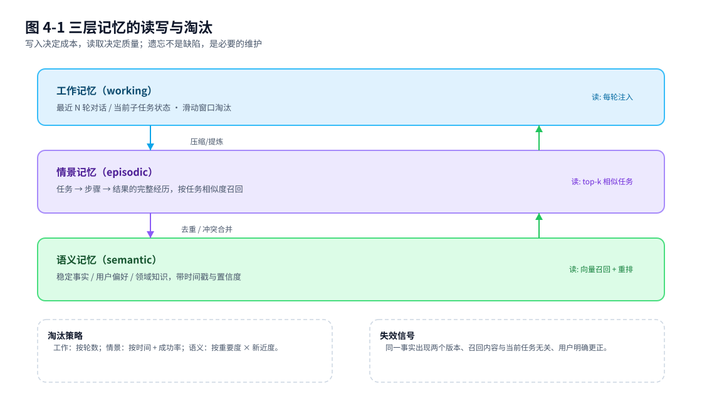

# 04 · 记忆系统：写入比读取更难

> 存储不是难点。难点是决定"什么值得记、什么时候忘、两条冲突的记忆听谁的"。

## 学习目标

读完本章，应当能够区分工作记忆、情景记忆与语义记忆各自的职责与淘汰策略，用重要度阈值控制写入成本并说清阈值化带来的漏记风险，设计"相似度 × 新近度 × 重要度"的召回打分，并处理记忆冲突与过期，避免模型自信地给出过时答案。

## 4.1 三种"记住"

| 需求 | 时间跨度 | 典型问题 | 对应层 |
|---|---|---|---|
| 记住刚才说了什么 | 一次会话 | 指代消解、上下文连续 | 工作记忆 |
| 记住上次这类任务怎么做 | 跨会话 | 复用成功路径、避开失败路径 | 情景记忆 |
| 记住用户是谁、偏好什么 | 长期 | 个性化、少问重复问题 | 语义记忆 |

把三者混成一份"聊天历史"，是记忆系统最常见的失败：历史越滚越长，关键事实被埋在中间，而成本随长度线性上升。三种记忆的淘汰依据本来就不同，工作记忆按轮数滑窗，情景记忆看时间与成功率，语义记忆看重要度与新近度，混成一份之后，三套依据都无法执行。

## 4.2 三层架构



*图 4-1　写入向下沉淀（压缩、合并），读取向上装配（召回、注入）。两层之间的箭头由策略触发，不会自动发生。*

| 层 | 存什么 | 写入触发 | 淘汰 | 读取 |
|---|---|---|---|---|
| 工作记忆 | 最近 N 轮对话 | 每轮 | 滑动窗口 | 每轮全量注入 |
| 情景记忆 | 任务→步骤→结果 | 任务结束且成功/失败明确 | 时间 + 成功率 | 任务相似度 top-k |
| 语义记忆 | 事实、偏好、领域知识 | 重要度 ≥ 阈值 | 重要度 × 新近度 | 向量召回 + 重排 |

## 4.3 写入：为什么贵

一次写入通常包含四个动作：抽取（把对话变成事实）、去重（和已有记忆比相似度）、冲突检测（新事实是否与旧事实矛盾）、落库。每一步都可能调用模型或做向量计算。

用重要度阈值可以把成本压到可控：

```python
manager.remember("门店 A 的退货率连续两季高于均值", importance=0.8)  # 写入
manager.remember("今天天气不错", importance=0.1)                       # 丢弃
```

阈值的代价是漏记：一句轻描淡写的"以后都发邮件给我"可能只有 0.4 的重要度，却是一个强偏好。缓解办法是保留两条通道。规则通道在出现"以后""总是""不要"等词，或出现明确的人名、数字、日期时直接提权；手工通道允许用户显式说"记住这一点"，绕过硬阈值。

去重同样重要。同一事实被记十遍，会挤占召回名额并放大它的权重。工程上用近似去重即可，字符 n-gram 的 Jaccard，或向量余弦大于 0.9，都不必上复杂的实体消解。

## 4.4 读取：三因子打分

单一相似度排序会产生"永远召回同一条"的问题。实践中更稳的打分是三项加权：

$$
\text{score}(m)=\alpha\cdot \text{sim}(q,m)+\beta\cdot e^{-\lambda \Delta t}+\gamma\cdot \text{importance}(m)
$$

- $\text{sim}$：向量余弦或 BM25 归一化分数；
- $e^{-\lambda \Delta t}$：新近度，$\lambda$ 取 0.01/天量级时，半衰期约 70 天；
- $\text{importance}$：写入时的重要度，用于保证"关键事实不因时间久而被挤掉"。

起点可以取 $\alpha=0.6,\ \beta=0.25,\ \gamma=0.15$。三个权重应当按业务调：客服场景更看新近度，合规场景更看重要度。

召回数量 $k$ 也要克制。$k=3$ 通常优于 $k=8$：更多片段带来更多噪音，而模型的注意力并不会因此更均匀。

## 4.5 冲突与遗忘

两条记忆矛盾时（"偏好邮件" vs "偏好电话"），不能让它们同时生效。低成本的解法是把时间戳一起交给模型：

```text
[长期事实]
- (2024-09-12, 置信度 0.9) 用户偏好邮件通知
- (2024-11-03, 置信度 0.9) 用户偏好电话通知，邮件经常漏看
```

模型看到日期后，通常会自动采用较新的一条。若要更严格，就在读取侧做"同槽位只保留最新"的合并。

遗忘不是可选项。过期事实比没有事实更危险：它会让模型自信地给出错误答案。维护手段有三类：价格、库存、政策类事实带 TTL，过期即不召回；用户说"不对"时，把旧记忆标记为 `superseded`，不直接删除，以便保留审计链；每类记忆设条数上限，超出时按打分淘汰，避免无限膨胀。

## 4.6 实现与演示

`learning_agents/memory.py` 提供四个可直接用的组件：

```python
from learning_agents.memory import BufferMemory, EpisodicStore, MemoryManager, VectorMemory

store = EpisodicStore("memory/episodes.jsonl")
store.append("统计上季度退货率", "退货率 3.2%，低于阈值 5%", ["sql"], True)

manager = MemoryManager(buffer=BufferMemory(max_turns=2),
                        semantic=VectorMemory(), episodic=store, token_budget=600)
manager.observe("user", "我们上季度的退货率是多少？")
manager.remember("门店 A 的退货率连续两季高于均值", importance=0.8)
print(manager.build_context("退货率 门店 A 的对比", k=2))
```

`HashingEmbedder` 用特征哈希把 token 映射到 256 维单位向量。它不是语义模型，但保留了词面相似性，足以演示"写入—召回—装配"的完整链路；换成真实 embedding 只需替换 `embed` 方法。

情景记忆用任务相似度召回，适合"这类报表上次是怎么做的"：

```python
store.similar_tasks("再统计一次退货率")
# [{'task': '统计上季度退货率', 'answer': '退货率 3.2%，低于阈值 5%', ...}]
```

## 4.7 怎么评估记忆

| 指标 | 定义 | 采集方式 |
|---|---|---|
| 命中率 | 需要记忆时，正确事实出现在上下文中的比例 | 构造"必须依赖记忆"的用例 |
| 污染率 | 不相关或过期记忆被注入的比例 | 人工抽检 + 规则检测 |
| 写入成本 | 每千轮对话的抽取调用次数与 token | 轨迹统计 |
| 冲突率 | 同一槽位出现多版本的比例 | 定期扫描 |

前三项决定"值不值得做"，第四项决定"要不要停下来清理"。

## 工程要点

记忆是有状态服务，必须能导出、能回滚、能按用户删除。写入路径要幂等，同一条事实重复写入不应产生多份记录。

不要把整段对话存进语义记忆，先抽取成事实再存。读取时给每条记忆带上来源与时间，模型才有可能正确处理冲突。

## 常见失败模式

不设阈值、什么都记住，三个月后召回全是噪音，成本翻倍。摘要吃掉数字也同样常见：把"3.2%"压成"较低"，后续步骤就无法引用。忘记遗忘的代价是把去年的价格当成现价，而且模型给出答案时相当自信。跨用户串味则属于安全事故：记忆没有按租户隔离，A 的偏好出现在 B 的上下文里。

## 练习

1. 给 `MemoryManager` 增加 `forget(key, reason)`，把记忆标记为失效而非删除，并补测试。
2. 用 `score = α·sim + β·recency + γ·importance` 重写 `VectorMemory.search`，观察召回排序变化。
3. 构造一组"记忆冲突"用例：同一偏好两个版本，验证时间戳注入后模型选择较新的一条。

## 参考

- Packer et al., *MemGPT: Towards LLMs as Operating Systems*, 2023. <https://arxiv.org/abs/2310.08560>
- 代码：`learning_agents/memory.py`、`learning_agents/demo.py`（场景 4）
