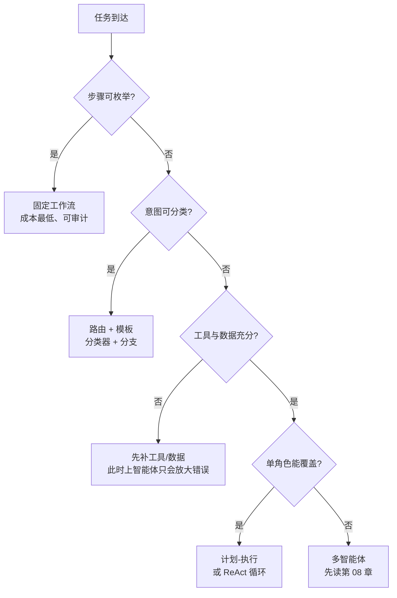
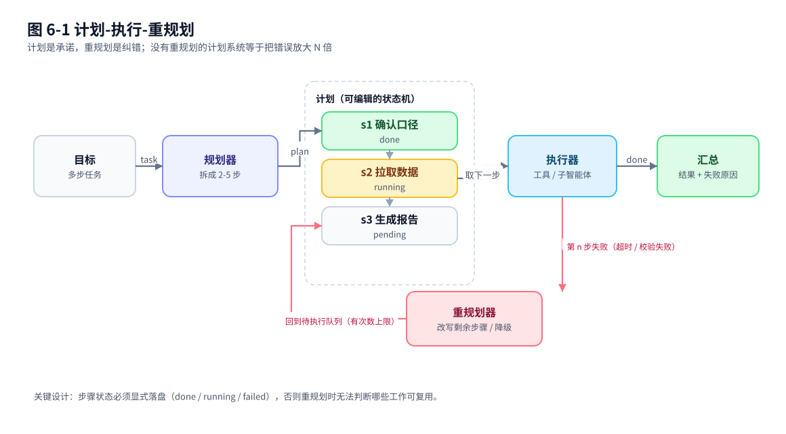

# 05 · 规划与路由：先想清楚，还是边做边想

> 规划的价值不止于让模型"多想一会儿"。它要把隐式推理变成可检查、可修改、可重放的中间产物，有了产物，规划才谈得上被评审、被回退。

## 学习目标

读完本章，应当能够用一张判定图在固定工作流、路由、计划执行与自主循环之间做出选择，写出可验证的计划并交代粒度、依赖与降级路径，实现带次数上限的重规划并说明上限为什么必须存在，用任务图表达并行分支，解释拓扑分层解决了什么问题。

## 5.1 先选结构，再谈实现

多数"智能体效果不好"的问题，根源是控制结构选错了：用一个自由循环去处理本就固定的流程，或者用固定流程去套一个边界模糊的任务。



这张图的价值在于它把"要不要上智能体"变成一个可以回答的问题，而不是一种信仰。越往下的分支，成本与方差越大。

## 5.2 路由：一步决策的性价比

路由是最被低估的结构。它只做一次分类，却能把 80% 的请求导向确定性路径，只让 20% 的长尾进入自主循环。

```python
router = Router({"billing": ["退款", "发票"], "tech": ["报错", "超时"]})
router.decide("接口超时了")     # 'tech'
router.decide("随便聊聊")       # 'general'（兜底）
```

路由有三条工程要求。兜底分支必须存在，并且能升级到人工或自主循环；分类结果要落盘，否则无法统计"路由错了多少"；分类器与处理器解耦，换模型、换规则都不影响下游。

路由的失败模式是"边界请求"：一句"我要退款，但系统一直报错"同时命中两个类别。稳妥做法是允许多标签，按优先级取第一个可处理的，并把未处理的标签写进工单。

## 5.3 计划-执行-重规划



*图 5-1　计划是可编辑的状态机；失败时回到待执行队列，而不是从头再来。*

最小实现只需要三个角色：

```python
plan = Planner().from_template(
    ["确认数据口径", "拉取明细数据", "生成汇总报告"],
    tools=["spec_lookup", "sql_query", ""],
)
runner = PlanAndExecute(executor=run_step, replanner=replan, max_replans=1)
runner.run(plan)
```

`executor` 负责执行单步，`replanner` 负责在失败后改写剩余步骤。两者分离的好处是：执行逻辑可以单测，重规划策略可以单独评估。

重规划必须设上限。重规划本身会消耗模型调用；若失败原因是系统性的，例如表不存在、权限不足，重规划只会不断生成"看起来可行"的新计划，把一次 3 秒的失败拖成 30 秒的超时。上限通常取 1—2 次，超过即上报。

## 5.4 什么是一个好计划

用四条标准检查模型产出的计划：

| 标准 | 检查问题 | 不合格的例子 |
|---|---|---|
| 可验证 | 每步有明确的完成判据吗 | "分析数据" |
| 粒度合适 | 一步是否约等于一次工具调用 | "查数据并写报告并核对" |
| 依赖显式 | 哪些步骤可以并行 | 未标注依赖，串行执行 |
| 可降级 | 失败时有没有替代路径 | 只有一条路径 |

"分析数据"之所以不合格，是因为无法判断是否完成；改成"按门店汇总近 90 天退货率，输出 CSV"，就同时获得了可验证性与粒度。

计划步骤还应当携带预期产物。有了产物声明，执行器就能校验"这一步真的产出了东西"，不再只看工具是否返回 200。

## 5.5 任务图：把并行写进结构

当步骤之间存在依赖时，用图表达依赖关系，列表无法承载这种结构。`TaskGraph` 用拓扑排序分层，同一层可以并行：

```python
graph = TaskGraph()
graph.add("抓取", fetch)
graph.add("抽取1", extract_a, deps=["抓取"])
graph.add("抽取2", extract_b, deps=["抓取"])
graph.add("汇总", merge, deps=["抽取1", "抽取2"])

graph.layers()   # [['抓取'], ['抽取1', '抽取2'], ['汇总']]
graph.run(parallel=True)
```

分层的意义在于把"能并行"变成结构事实，调度不再依赖执行器的直觉。它同时天然检测循环依赖：若某一层为空而仍有剩余节点，说明图里有环。

## 5.6 动态重规划 vs 一次性计划

| 维度 | 一次性计划 | 动态重规划 |
|---|---|---|
| 成本 | 一次规划调用 | 每次失败一次额外调用 |
| 适应性 | 差（环境变化即失效） | 好 |
| 可预测性 | 高（可提前估算步数） | 低 |
| 适用 | 步骤稳定、工具可靠 | 工具不稳定、环境开放 |

折中方案是分段计划：一次只规划随后的 3 步，执行完再规划下一段。它保留了适应性，又把单次规划的上下文控制在可控范围。

## 工程要点

计划的每一步都要能映射到一次工具调用或一次子智能体调用；映射不了，说明粒度错了。计划要落盘（`Plan.to_dict()`），失败时才能对比"计划中的依赖"与"实际的失败点"。

重规划要带失败原因，否则模型会生成与上次几乎相同的计划。路由与计划都需要评估集：前者看分类准确率，后者看计划可执行率，也就是步骤一次通过的比例。

## 常见失败模式

计划幻觉是规划器最容易犯的错：模型规划了"调用内部风控接口"，系统里却没有这个工具，规划器的提示里必须带真实工具清单。过度规划则从另一头浪费预算，三步能完成的任务拆成十二步，每步都要一次模型调用，成本翻四倍而质量不变。无降级的串行会让第二步的失败作废后面全部工作，高风险步骤应当在计划阶段就准备替代路径。把重规划当重试使同样有害：参数错误也触发重规划，结果生成一堆换汤不换药的计划。

## 练习

1. 用 `Router` 实现一个三分类工单路由，构造 20 条测试语句，统计准确率与兜底比例。
2. 给 `PlanAndExecute` 增加"步骤超时"参数，并让超时与业务失败走不同的重规划策略。
3. 用 `TaskGraph` 表达"三个数据源并行抓取 → 合并 → 生成报告"，比较串行与并行的总耗时。

## 参考

- Wei et al., *Chain-of-Thought Prompting*, 2022. <https://arxiv.org/abs/2201.11903>
- Wang et al., *Plan-and-Solve Prompting*, 2023. <https://arxiv.org/abs/2305.04091>
- 代码：`learning_agents/planning.py`、`learning_agents/demo.py`（场景 6、9）
