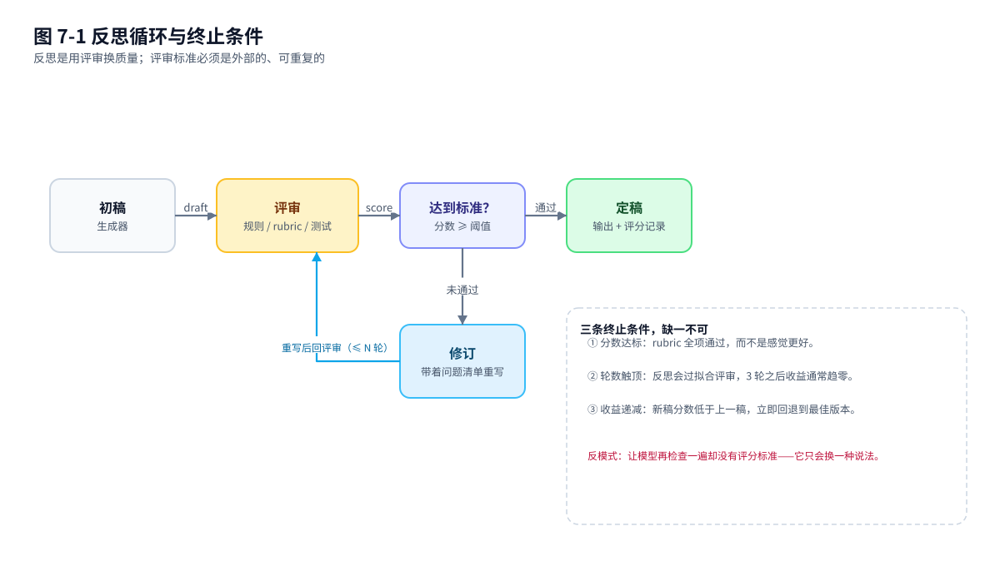

# 06 · 反思与自我修正：用评审换质量

> 反思只有在"评审标准是外部的、可重复的"时才有效。否则它只是让模型换一种说法再说一遍。

## 学习目标

读完本章，应当能够区分自评、外部规则与执行结果三种反馈源，为反思循环设计三条终止条件以避免无限改稿与过拟合，实现"捕获错误、生成补丁、重新执行"的自愈代码，并判断哪些任务的反思注定无效，把算力挪到别处。

## 6.1 三种反馈源

| 反馈源 | 例子 | 可靠性 | 成本 |
|---|---|---|---|
| 自评 | 让模型给自己的答案打 1—10 分 | 低（分数漂移、偏乐观） | 一次调用 |
| 外部规则 | 单元测试、schema 校验、引用检查 | 高 | 近乎零 |
| 执行结果 | 代码报错、接口 4xx、检索为空 | 高 | 已支付 |

三种反馈源的可靠性差异很大，能拿到执行结果就不要用自评。自评的价值只在"没有可执行判据"的开放任务上，例如写作、方案设计，而且必须配一个固定的 rubric，否则同一份稿子两次评分能差 2 分。



*图 6-1　生成—评审—修订的闭环。三条终止条件里，只有"分数达标"是正向信号，其余两条都是止损。*

## 6.2 三条终止条件

```python
loop = ReflectionLoop(generate, revise, critic, max_rounds=3, min_gain=0.02)
out = loop.run("如何避免智能体在失败路径上失控？")
```

循环在三种情况下停下。rubric 全项通过算达标，加权平均过线不算数，因为平均分会掩盖某一项的严重缺陷，比如缺少引用。轮数触顶也停，默认 3 轮，经验上第 4 轮之后改动幅度小于评审噪声，收益趋零。收益递减同样停：新稿分数低于上一稿时立即回退到最佳版本，没有这条，反思循环可能在两个版本之间来回震荡。

`ReflectionLoop` 还保留了每轮的问题清单：

```text
round 0: score=0.25 issues=['篇幅不足（22 字）', '缺少来源引用标记 [n]', "缺少要点：['重规划', '上限']"]
round 1: score=1.0  issues=[]
通过=True 轮数=1
```

问题清单比分数更有用：它是下一轮修订的输入，也是事后归因的证据。

## 6.3 评审器怎么写

一个可解释的评审器只需要四类检查（`HeuristicCritic`）：

```python
critic = HeuristicCritic({
    "min_chars": 120,
    "require_citation": True,
    "required_terms": ["重规划", "上限"],
    "banned_phrases": ["众所周知"],
})
```

四类检查分别是长度、结构、要点覆盖与空话检测。长度防敷衍，但不该作为主要指标；结构看引用标记、编号与字段是否齐全；要点覆盖看任务要求的关键概念是否出现；空话检测针对"众所周知""毋庸置疑"这类填充。

要避免的评审器是"让模型自由发挥地挑毛病"：它倾向于给出风格化建议（"可以更生动"），而这些建议无法被验证，也无法收敛。

需要模型评审时，用成对比较代替绝对打分：给两份稿子，问"哪份更好地满足了下列三条标准"。成对比较的稳定性显著高于 1—10 分制，也更容易做成 A/B 评估。

## 6.4 自一致性：用采样换稳定

在不改变模型的前提下，多次采样再投票是最便宜的稳定性手段：

```python
self_consistency(["方案 A", "方案 A", "方案 B"])
# {'answer': '方案 A', 'votes': 2, 'total': 3, 'agreement': 0.667}
```

适用条件：任务有离散答案（分类、选项、是否），且单次采样成本可接受。对开放式写作无效，三篇不同的文章没有"多数票"。

## 6.5 自愈代码

代码任务有最理想的反馈源：解释器。`CodeHealer` 的循环是"执行 → 抓错 → 让模型改 → 再执行"：

```python
healer = CodeHealer(fixer=fix, max_rounds=3, timeout=5.0)
result = healer.run("print('hello'\n")   # 语法错误
# {'ok': True, 'rounds': 1, 'output': 'hello'}
```

隔离执行靠三样东西：子进程、超时与独立临时目录。这是最低限度的隔离，生产环境应当换成容器或专用沙箱。回灌时只保留错误堆栈的末尾 20 行与异常类型，完整堆栈往往几百行，全塞回去只会挤占上下文。轮数限制在 3 轮，修复循环很容易在"改坏—再改"之间震荡。

自愈的收益随错误类型差异很大：语法错误几乎一次就好；逻辑错误（结果不对但不报错）需要测试断言，否则模型无从判断自己是否改好了。

## 6.6 什么时候反思无效

| 情形 | 原因 | 替代方案 |
|---|---|---|
| 信息不足 | 评审也无法凭空补出事实 | 先补检索或追问 |
| 标准模糊 | 没有可判定的 rubric | 先写验收标准 |
| 模型能力上限 | 它不知道自己错在哪 | 换更强模型或拆任务 |
| 已经收敛 | 改动小于噪声 | 停，进入评估环节 |

表格末行最容易被忽略：团队常常在"再改一版"上花掉比"重新设计"更多的预算。

## 工程要点

评审器与生成器用不同的提示，最好用不同的模型；同一提示自评，倾向于自我确认。每轮保存完整版本，便于回退与对比，只保存最终稿会丢掉最有价值的对照。

反思的收益要计入成本：三轮反思等于三次生成加三次评审，用在简单任务上通常不划算。对结构化输出，反思应当退化为校验加重试一次，开放式改写没有意义。

## 常见失败模式

没有标准的反思等于没有反思：提示只写"请检查并改进"，模型只会做同义替换。分数漂移会让循环在两个版本之间震荡，同一稿两次评分差 2 分就足以触发。越改越差源于缺少回退机制，最终那一版反而可能是最差的。评审泄露更隐蔽：把参考答案放进评审提示，评审判定"通过"，但答案其实是抄的。

## 练习

1. 给 `HeuristicCritic` 增加"引用编号必须连续"的检查，并构造一个不连续的样例。
2. 用 `ScriptedLLM` 模拟一个"越改越差"的模型，验证 `ReflectionLoop` 会回退到最佳版本。
3. 给 `CodeHealer` 增加一个"两次补丁相同则停止"的判定，解释它防的是什么。

## 参考

- Madaan et al., *Self-Refine: Iterative Refinement with Self-Feedback*, 2023. <https://arxiv.org/abs/2303.17651>
- Shinn et al., *Reflexion*, 2023. <https://arxiv.org/abs/2303.11366>
- Wang et al., *Self-Consistency Improves Chain of Thought Reasoning*, 2022. <https://arxiv.org/abs/2203.11171>
- 代码：`learning_agents/reflection.py`、`learning_agents/demo.py`（场景 7）
