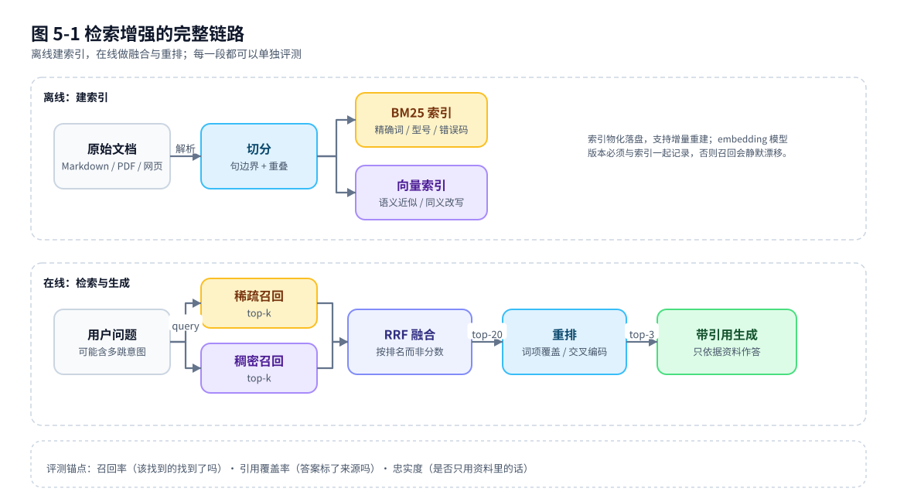

# 07 · 检索增强：把记忆换成可核验的资料

> RAG 的收益来自可核验：每条结论都能被指回一段原文。上下文再长，没有引用的 RAG 也只是把幻觉换了个来源。

## 学习目标

读完本章，应当能够说清 RAG 链路上每一段的职责与该段的典型失败，按文档类型选择切分粒度与重叠比例并解释参数变化的后果，说明 BM25 与向量召回为何互补、RRF 为什么比分数加权更稳，并用召回率、引用覆盖率、忠实度三个指标评估链路。

## 7.1 三种知识来源的取舍

| 来源 | 时效 | 可核验 | 成本 | 适用 |
|---|---|---|---|---|
| 参数记忆（模型权重） | 训练截止 | 否 | 已支付 | 常识、语言能力 |
| 上下文注入（RAG） | 实时 | 是（有原文） | 检索 + token | 政策、文档、内部知识 |
| 工具查询（API/SQL） | 实时 | 是（有返回值） | 一次调用 | 结构化数据、精确计算 |

三者的边界要提前划清。参数记忆能提供的只有训练截止之前的常识与语言能力，凡是需要指出出处的结论都不应落在权重里；上下文注入能提供实时资料，代价是检索加 token；工具查询返回精确值，适合结构化数据与计算。能用 SQL 得到精确数字的场景，不要用 RAG 去读文档找数字，后者既慢又容易错。RAG 擅长的是非结构化文本里的语义匹配，例如同一制度的不同表述或条款关联。

## 7.2 链路与职责



*图 7-1　离线建索引、在线融合重排。每一段都可以单独替换、单独评估。*

| 阶段 | 职责 | 典型失败 |
|---|---|---|
| 切分 | 保住语义单元，控制块长 | 把表格切成两半，数字与表头分离 |
| 索引 | 支持精确匹配与语义匹配 | 索引与 embedding 版本不一致，静默漂移 |
| 召回 | 两路各取 top-k | 只做向量，型号/错误码召回不到 |
| 融合 | 合并两路结果 | 用分数加权，量纲不可比 |
| 重排 | 用更贵的模型精排 | 候选太少，重排无从发挥 |
| 生成 | 只依据资料作答并标注 | 引用编号与片段错位 |

## 7.3 切分：参数与后果

```python
chunks = chunk_text(text, size=320, overlap=60, source="policy")
```

块长取 200 至 400 字，是中文文档的常用区间。切得太碎，单块缺少上下文，答案容易断章取义；切得太大，检索精度下降，还会占用过多预算。重叠取 10% 至 20%，防止答案被切在边界上，代价是索引膨胀与重复召回。切分点优先落在句号与换行处，表格和代码块整体保留，并单独标注类型。一个常被忽略的事实是，切分策略决定了召回率的上限：答案一旦被切散在两个块里，再好的重排也拼不回来。评估时应当专门检查期望引用的块 id 是否被切分破坏，这一步能解释相当一部分召回失败。

## 7.4 混合检索与 RRF

BM25 与向量召回擅长的东西不同。BM25 依赖词频与逆文档频率，对精确词极强，型号 `X200-Pro`、错误码 `E1024`、专有名词都靠它兜住，遇到同义改写则无能为力。向量召回依赖语义空间，同义表达是它的强项，对精确字符串偏弱，容易给出看起来相关但答非所问的结果。两路各取 top-k 再融合，才能同时覆盖这两类查询。

融合两路最省心的方式是倒数排名融合（Reciprocal Rank Fusion）：

$$
\text{score}(d)=\sum_{r\in\{\text{bm25},\text{dense}\}} \frac{1}{k+\text{rank}_r(d)},\quad k=60
$$

它只用排名、不用分数，不必把两种量纲校准到一起，这也是它比分数加权更稳的原因。代价是丢掉分差信息，当第一名遥遥领先时，RRF 会把这点优势抹平。若业务对强匹配敏感，可以在 RRF 之后叠加一个小的原始分数项。

```python
pipeline = RAGPipeline().index(docs, size=220, overlap=40)
hits = pipeline.retrieve("记忆写入为什么昂贵？", k=3)
```

## 7.5 重排：廉价的第二次机会

召回阶段追求不漏，重排阶段追求排准。词项覆盖率统计查询词在候选块中的覆盖比例，零成本、可解释，能修正明显的排序错误。交叉编码器把 (query, passage) 一起送进模型打分，效果好，代价是每个候选一次前向，成本随候选数线性增长。工程上的折中是召回 20 至 50 个候选，用交叉编码器重排到 3 至 5 个。候选太少，重排没有发挥空间；候选太多，延迟与成本不可接受。这个区间值得在自己的语料上量一次。

## 7.6 生成：忠实度优先

提示词里必须写死三件事：

```text
1. 只依据给定资料回答；
2. 资料不足时明确说"资料未覆盖"，不要推测；
3. 每个结论后用 [序号] 标注来源。
```

即便如此，模型仍可能引用错位：结论来自第 3 段，却标了 [1]。缓解办法是要求逐句引用，并在后处理里校验编号是否落在候选范围内，`citation_coverage` 做的就是这件事：

```python
{"answer": "写入是昂贵的：抽取事实要调用模型，去重要做相似度比较……[1][2]",
 "citations": [{"id": "notes#7", "score": 0.52}, ...],
 "coverage": 0.667}
```

忠实度（faithfulness）比答案好不好更值得优先保障。一段措辞平庸但有据可查的答案，远好过一段漂亮但编造的答案：前者可以复核，后者只能重跑一次再赌运气。

## 7.7 三个评估指标

| 指标 | 问题 | 计算 |
|---|---|---|
| 召回率 recall@k | 该找到的资料找到了吗 | 期望块 id ∩ 命中块 id / 期望块数 |
| 引用覆盖率 | 答案是否标注了来源 | 被引用的命中块 / 命中块总数 |
| 忠实度 | 答案是否只用了资料里的内容 | 人工抽检或模型逐句核对 |

前两个指标可以完全规则化，适合放进 CI；忠实度成本高，按发布节奏抽样。三者要一起看：召回率高而覆盖率低，说明模型不爱引用；覆盖率高而忠实度低，说明它在引用着编；召回率本身低，则要回头查切分与索引版本。

## 工程要点

索引与模型版本要绑定。换 embedding 模型必须重建索引，并在元数据里记录版本，否则召回会静默漂移，而漂移在指标上只表现为答非所问，很难归因。片段去重不能省：重叠切分会产生近乎重复的句子，生成前不去重，答案就复读同一段话。

来源元数据要保留文件名、段落号与更新时间，没有元数据的引用等于没有引用。注入量也要控制，top-3 通常优于 top-8，多出来的片段会稀释注意力，最相关的那一段反而被淹没。

## 常见失败模式

| 失败 | 表现 | 改法 |
|---|---|---|
| 切碎表格 | 表头与数据分离，模型把列名对错 | 表格整体保留并转成 Markdown |
| 只做向量 | 型号、错误码召回不到，用户觉得"它没看懂我的问题" | 补 BM25 一路，用 RRF 融合 |
| 引用幻觉 | 答案里的 [1] 指向一段无关内容 | 校验引用编号落在候选范围内 |
| 资料相互矛盾却不标注 | 两个版本的制度同时被召回，模型随机选一个 | 在证据表里显式标注冲突 |
| 把摘要当原文 | 二次摘要过的资料被当权威来源引用，错误被放大 | 引用指向原文而不是摘要 |

前两类属于建库阶段的问题，重跑一次评估就能从召回率上看出来；中间两类落在生成阶段，要靠抽检轨迹；把摘要当原文要在入库时拦住，事后很难分辨。

## 练习

1. 用 `recall_at_k` 为 20 条测试问题建基线，然后调整 `size` 与 `overlap`，观察召回率变化。
2. 关掉 BM25，只用向量召回，构造一条包含型号的查询，比较两种配置的命中差异。
3. 给 `_extractive_answer` 增加"证据冲突检测"：同一问题召回的两段给出相反结论时，输出两个来源并标注冲突。

## 参考

- Lewis et al., *Retrieval-Augmented Generation for Knowledge-Intensive NLP Tasks*, 2020. <https://arxiv.org/abs/2005.11401>
- Cormack et al., *Reciprocal Rank Fusion Outperforms Condorcet and Individual Rank Learning Methods*, 2009.
- 代码：`learning_agents/rag.py`、`learning_agents/demo.py`（场景 5）
