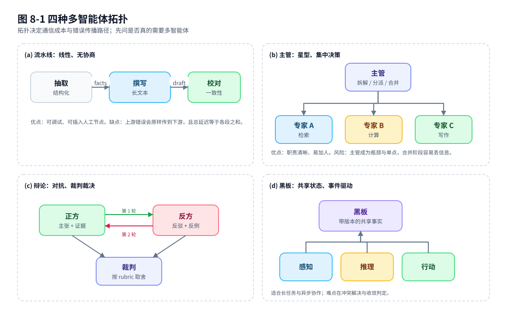

# 08 · 多智能体：先证明单智能体不够用

> 多智能体的收益来自"角色专业化 + 独立上下文"，代价是通信开销与错误传播。绝大多数场景不需要它。

## 学习目标

读完本章，应当能够用三条判据判断是否真的需要多智能体，区分四种拓扑的通信成本与错误传播路径，实现一个主管式系统并说明分派与合并为什么是最容易出错的两处，并估算多智能体的真实成本，给出可接受的轮数上限。

## 8.1 三条判据

满足全部三条，才值得引入多智能体。角色要确实异质：不同角色需要不同的系统提示、工具集或知识边界，这些差异无法用一段提示表达。上下文要确实会互相污染：把两类工作放进同一上下文会显著降低质量，审稿需要挑剔，写稿需要发散，这两种要求放在一起会互相抵消。错误要能被隔离：一个角色的失败不会无声地污染全局，或者有明确的仲裁机制。三条里缺一条，单智能体加更好的工具与提示通常更便宜、更可控。

多智能体不会让模型变聪明，只会让不同的提示各自发挥。单角色提示没写好，拆成三个角色只会得到三份没写好的输出，还要多付几倍的调用费用。

## 8.2 四种拓扑



*图 8-1　从左上到右下：通信成本与调试难度递增。*

| 拓扑 | 通信 | 优点 | 风险 | 适用 |
|---|---|---|---|---|
| 流水线 | 单向传递 | 可调试、可插人工 | 上游错误原样下传 | 写作、ETL |
| 主管 | 星型 | 职责清晰、易扩展 | 主管瓶颈、合并丢信息 | 多来源调研 |
| 辩论 | 双向对抗 | 压测论证、暴露盲点 | 同质化、成本 ×N | 判断类任务 |
| 黑板 | 共享状态 | 支持长任务、异步 | 冲突难解、难收敛 | 复杂分析 |

## 8.3 消息还是共享状态

两种协作机制的选择，取决于任务是否需要阶段性共识。消息传递用于主管与流水线，每个角色只看到自己被交给的任务与必要上下文，好处是上下文干净，坏处是无法感知全局进展。共享状态用于黑板，所有角色读写同一份带版本的事实，信息对称，代价是需要冲突解决与收敛判定，而这两件事本身就要写不少代码。

`Blackboard` 的最小实现只有写、读、历史三个操作，关键是写入幂等：值未变则不产生新版本，这样"事件数不再增长"就可以作为收敛判据。

```python
board.write("k", 1, "a")   # version 1
board.write("k", 1, "b")   # 值未变，仍为 version 1
board.write("k", 2, "b")   # version 2
```

## 8.4 主管式系统

```python
supervisor = Supervisor(
    workers=[researcher, writer, reviewer],
    plan=lambda task: ["梳理事实", "撰写初稿", "审校定稿"],
    assign=lambda sub: {"梳": "researcher", "撰": "writer", "审": "reviewer"}[sub[0]],
)
result = supervisor.run("写一篇关于智能体评估的短文")
```

分派与合并是最容易出错的两处。分派靠关键词匹配角色名，在真实任务上很快失效，稳妥做法是让主管输出结构化的 `{"subtask": ..., "role": ...}`，并对未知角色做兜底。合并的默认实现是把各角色的输出按标题拼接，这会丢掉冲突信息，更好的合并是先列冲突再裁决，并保留每个结论的来源角色。主管还有一个隐性成本：它是单点。一次错误分派会让三个专家白干，主管的上下文也会随子任务增多而膨胀，实践中应限制子任务数，3 至 5 个为宜。

## 8.5 辩论：何时有用，何时是浪费

辩论的价值在于暴露盲点，它并不负责投票选出正确答案。它适合方案取舍（A 还是 B 且两边都有道理）、需要有人专门唱反调的风险评估，以及需要交叉质证的事实核验。有客观答案的计算题直接算更快，创意生成在对抗中会收敛到平庸，成本敏感的场景每轮都是 N 次调用，这三类都不适合辩论。最大的风险是同质化：正方与反方由同一个模型扮演时，论点往往镜像对称，看似激烈，实则没有新信息。缓解办法是给双方不同的材料与不同的评分标准，条件允许时换用不同模型。

## 8.6 错误传播与收敛

多智能体系统的失败，常见形态是错误在角色之间往返放大，单个角色出错反而容易发现。研究员把不确定的结论写成肯定句，撰稿人照抄并加上更肯定的措辞，审校只检查语句通顺而不核对事实，最终交付一份语气坚定、事实存疑的报告。整条链路上没有一处报错，每一棒都在上一棒的基础上又加了一点确定性。

三道防线可以挡住这类放大。证据随结论走，每个结论必须带来源，没有来源的结论在合并阶段被降级；审校有否决权，不通过时回到撰稿，直接交付的口子要堵住；全局设预算，给整个协作定 token 与轮数上限，避免越讨论越贵。

## 8.7 成本模型

设 $N$ 个角色、$R$ 轮、每次调用平均 $T$ token，则总成本约为

$$
C \approx N \cdot R \cdot T \cdot c
$$

其中 $c$ 为单价。对比单智能体的 $R \cdot T \cdot c$，多智能体的成本是 $N$ 倍。这解释了为什么多智能体在 demo 里惊艳、在生产里昂贵：它买到的是并行的专业化，推理能力本身没有变好。

一个实用的止损线：如果单智能体在评估集上的通过率已经 ≥ 85%，再上多智能体的边际收益通常不足以覆盖成本。

## 工程要点

角色名、职责、输出格式都要写进系统提示，且彼此不重叠。每次交接都记录 `sender / recipient / 摘要`，否则排障时无法还原决策链。

合并阶段必须能表达两个角色结论冲突这种情况，不能强行合成一段通顺的话。每个角色还要有独立预算，避免一个话多的角色吃掉全局额度。

## 常见失败模式

| 失败 | 表现 | 改法 |
|---|---|---|
| 角色重叠 | 三个角色都在"分析"，只是措辞不同，等于同一个模型调用三次 | 让职责与工具集互不重叠 |
| 无仲裁 | 两个角色给出相反结论，系统直接把两段都贴进最终答复 | 合并阶段先列冲突再裁决 |
| 无限对话 | 角色之间互相"补充意见"，没有轮数上限 | 设全局轮数与 token 上限 |
| 上下文串味 | 把审校的挑剔语气带进撰稿上下文，导致越改越保守 | 每次交接只传必要摘要，不传全量上下文 |

这四类问题在 demo 里都不明显，因为演示用的任务短、角色少、语气统一。任务一长，角色重叠先表现为成本上升，无仲裁表现为答复自相矛盾，无限对话与上下文串味则要等轨迹攒够才能看出来。

## 练习

1. 给 `Supervisor` 增加"子任务失败重派"：某角色抛错时改派给备用角色，最多一次。
2. 用 `Debate` 实现"是否应该给退款设置 7 天时限"的论证，观察两轮之后是否出现新论据；若没有，说明原因。
3. 为 `BlackboardSystem` 设计一个收敛判据（例如"连续两轮无新事实"），并补测试。

## 参考

- Wu et al., *AutoGen: Enabling Next-Gen LLM Applications via Multi-Agent Conversation*, 2023. <https://arxiv.org/abs/2308.08155>
- Du et al., *Improving Factuality and Reasoning in Language Models through Multiagent Debate*, 2023. <https://arxiv.org/abs/2305.14325>
- 代码：`learning_agents/multiagent.py`、`learning_agents/demo.py`（场景 8）
