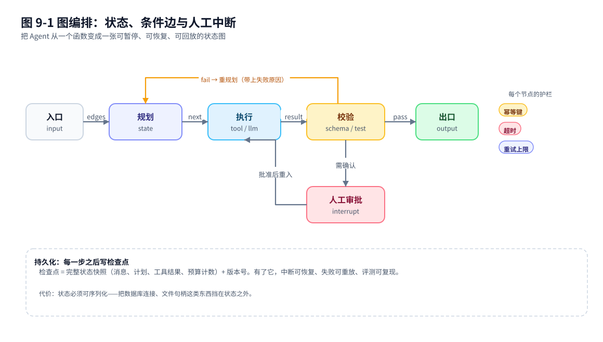

# 09 · 图编排：把循环变成可暂停的状态机

> 当一个 Agent 需要"停下来等人"、"失败后从中间恢复"、"跑完还能重放"，它就不再是一个函数，变成了一张状态图。

## 学习目标

读完本章，应当能够判断什么时候必须从手写循环升级为图编排，设计可序列化的状态并说明哪些东西不能进状态，用检查点实现中断恢复、用幂等键避免重放时重复副作用，并说清人工审批（HITL）的暂停与恢复语义。

## 9.1 三个升级信号

手写 `while` 循环能覆盖大部分单轮任务。只有出现下面三类需求中的任何一类，才值得引入图编排：需要暂停等人，例如审批、补充信息、人工接管；需要从中间恢复，例如进程重启、超时重试、跨天任务；需要分支与合并，例如不同路径汇合到同一节点，或多路并行后聚合。三类都不需要时，一个带预算的循环更简单，也更好调试。



*图 9-1　节点是纯函数，边是判定；检查点让整张图可以暂停、恢复、回放。*

## 9.2 状态设计三原则

状态必须可序列化。数据库连接、文件句柄、线程锁都不能放进去，所有外部依赖通过节点函数注入，不挂在状态上。这条约束在单机上显得多余，一旦要落盘、要跨进程恢复，它就成了硬要求。

状态要最小化。只放恢复执行所必需的东西：消息、计划、工具结果、预算计数、版本号。派生数据应当现算，例如渲染好的提示词，放进状态只会让状态与代码不一致。

版本要显式。状态带 `schema_version`，节点在读取时校验。没有版本号的状态，一次字段重命名就会让所有历史检查点失效。

```python
state = {
    "schema_version": 2,
    "messages": [...],          # 对话与观察
    "plan": {...},              # 计划及其步骤状态
    "tool_results": {...},      # 已执行工具的缓存（幂等重放用）
    "budget": {"tokens": 1200, "steps": 3},
    "pending_approval": None,   # HITL 的挂起点
}
```

## 9.3 检查点与幂等重放

检查点由状态快照、版本号与时间戳组成，每一步之后写一次。恢复时从最近的检查点加载，从下一个节点继续。这里有一个隐蔽的坑：重放会重复执行副作用。若第 3 步已发出退款，恢复后又执行一次，就是重复退款。两道防护挡的是不同情况：工具结果缓存把 `tool_results[call_id]` 存进状态，重放时命中缓存直接返回，不再调用；幂等键对每次副作用调用生成 `idempotency_key(tool, arguments)`，服务端按此去重。只做第一道不够，缓存可能丢失，换机器或者状态被截断都会丢，服务端的幂等才是兜底的那一层。

## 9.4 人工中断的语义

HITL 是一个正式的状态，不能用一个弹窗代替。

| 阶段 | 系统行为 | 需要落盘 |
|---|---|---|
| 触发 | 判定为高风险，写入 `pending_approval` | 待批动作、参数、理由、超时时间 |
| 暂停 | 停止推进，释放执行资源 | 完整状态快照 |
| 恢复 | 批准则继续，拒绝则改道 | 审批人、时间、决定、备注 |
| 超时 | 按预设策略处理（默认拒绝） | 超时事件 |

设计上有三个要点。默认拒绝，没有审批人响应时系统不能默认通过；可改道，拒绝之后不一定要终止任务，可以走降级路径，转人工、只读查询或者告知用户；审批可审计，谁、何时、依据什么批准，都要能被查出来。

## 9.5 条件边：确定性优先

边的判定函数应当尽量由代码完成，把模型留给确实需要判断的地方。

```python
def route_after_check(state):
    if state["check"]["ok"]:
        return "end"
    if state["check"]["needs_human"]:
        return "hitl"
    return "replan"
```

确定性的边可测试、可复现；让模型决定下一步去哪，会把分支数量与不可预测性同时放大。确实需要模型判断时，让它输出受限枚举（`pass / hitl / replan`），再由代码映射到边。

## 9.6 与手写循环的对比

| 维度 | 手写 while | 图编排 |
|---|---|---|
| 上手成本 | 低 | 中（要设计状态与节点） |
| 中断恢复 | 需要自己实现 | 检查点天然支持 |
| 分支表达 | if/else 嵌套 | 条件边，可视化 |
| 并行 | 手动线程 | 显式分支与汇合 |
| 可观测 | 靠日志 | 节点级事件天然对齐 |
| 过度设计风险 | 低 | 高（简单任务也上图） |

判据仍然是 9.1 的三条信号。为一张只有三个节点、没有分支的图引入完整编排框架，收益通常为负。

## 9.7 落地建议

先把状态结构定下来，再写节点。状态改一次，节点全改，这个顺序反过来会付出成倍的返工。每个节点保持纯函数，输入状态、输出状态增量，副作用集中在少数动作节点里。检查点写入要幂等，同一 `step_id` 重复写不应产生两条记录。整张图还要设一个最大节点数，防止条件边形成环。回放时用同一份检查点加同一份工具缓存，保证结果可复现，模型的非确定性除外，可以用固定种子或脚本模型。

## 工程要点

状态里只放可序列化的字段，连接、句柄、锁一律通过节点注入。检查点与工具缓存要一起落盘，只存状态不存缓存，重放时仍然会重复调用工具。

中断点要显式记在状态里：待批动作、审批人与超时策略，少一样都无法事后审计。副作用集中在少数动作节点，恢复时能复现的部分才多。

## 常见失败模式

| 失败 | 表现 | 改法 |
|---|---|---|
| 状态塞了不可序列化对象 | 上线后检查点写入失败，恢复功能形同虚设 | 状态只放可序列化字段，依赖通过节点注入 |
| 重放重复副作用 | 没有幂等键，恢复后重复发消息、重复扣款 | 工具结果缓存加服务端幂等键 |
| HITL 超时默认通过 | 把"没人管"当成"同意"，是典型的安全事故 | 超时按默认拒绝处理 |
| 图里藏环 | 条件边在某些输入下互相跳转，任务永不结束 | 设最大节点数并加环检测 |

## 练习

1. 为一个三步流程设计状态字典，标注哪些字段是"恢复必需"、哪些是"派生可算"。
2. 实现 `checkpoint.save/load`，并用脚本模型验证"中断在第 2 步后恢复，不重复执行第 1 步的副作用"。
3. 给 `route_after_check` 增加一个"连续两次校验失败则转人工"的规则，说明它防的是什么。

## 参考

- LangGraph 文档：*Persistence & Checkpointing*. <https://langchain-ai.github.io/langgraph/>
- 代码：`learning_agents/planning.py`（`TaskGraph`）、`learning_agents/multiagent.py`（`Blackboard`）
