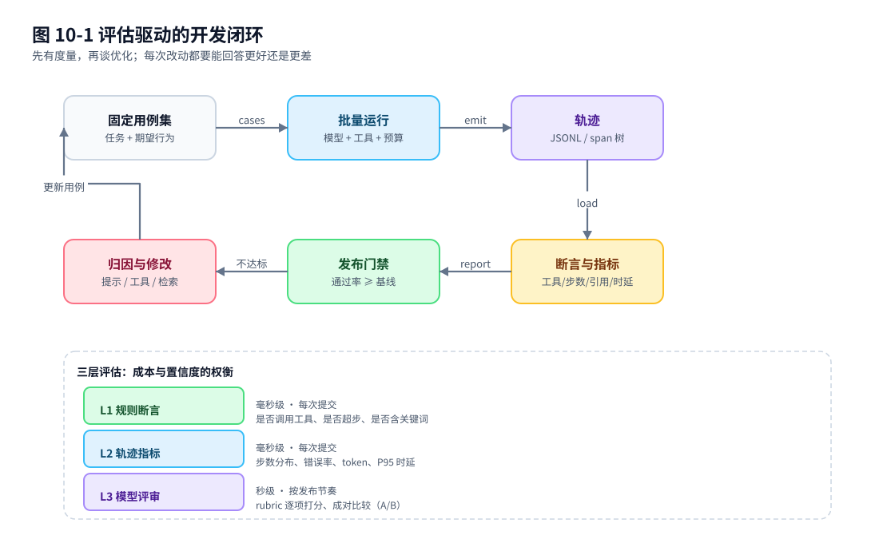

# 10 · 评估与可观测：没有度量就没有迭代

> 智能体的质量要看同一批用例上的通过率与成本，而不是"感觉变好了"。

## 学习目标

读完本章，应当能够搭起规则断言、轨迹指标、模型评审三层评估，从真实事故里长出一组回归用例，用轨迹判断失败属于模型选错还是工具不稳，并设计发布门禁，让变差在合并之前被发现。

## 10.1 为什么评估必须先行

传统软件里回归测试是标配，智能体项目里它常被推迟到功能稳定之后。结果是改动靠手感，退化靠用户投诉发现，同一个 bug 要修三次。评估的最小可行版本只需要一天：10 至 30 条用例、几条断言、一个脚本，先把这批用例跑通，再谈优化提示词。它带来的最大变化体现在讨论方式上，从"我觉得这个提示更好"变成"它在用例 7 和 12 上退化了"。前者无法验证，后者能立刻定位到具体输入与具体断言。分数只是副产品，讨论方式的变化才是这类项目最缺的东西。



*图 10-1　用例 → 运行 → 轨迹 → 断言 → 门禁 → 归因，闭环的每一段都要自动化。*

## 10.2 三层评估

| 层 | 频率 | 成本 | 回答的问题 |
|---|---|---|---|
| L1 规则断言 | 每次提交 | 毫秒 | 该调的工具调了吗？超步了吗？ |
| L2 轨迹指标 | 每次提交 | 毫秒 | 步数、错误率、token、P95 时延是否退化 |
| L3 模型评审 | 按发布节奏 | 秒/条 | 开放性质量是否提升（rubric / 成对比较） |

L1 与 L2 必须进 CI，L3 用于版本对比，不进每次提交。把 L3 塞进 CI 的直接后果是构建变慢、费用上升，评审分数抖动还会带来大量误报，团队很快就会学会忽略红色标记。

## 10.3 用例：从事故里长出来

一条好的用例包含五个字段：

```python
EvalCase(
    id="refund_boundary",
    task="客户订单金额 4999 元，要求退款",
    expected_terms=["审批"],
    required_tools=["lookup_policy"],
    forbidden_tools=["issue_refund"],     # 超阈值不得直接退款
    max_steps=6,
)
```

`expected_terms` 是答案必须包含的关键词，用起来要谨慎，容易变成背答案；`required_tools` 与 `forbidden_tools` 是比文本断言更稳定的行为断言，前者保证该查的政策查了，后者保证超阈值的动作没有发生；`max_steps` 防止答对了却绕了十步的情况。

用例有三个来源：线上事故的价值最高，产品需求边界与模型已知弱点各占一部分。每条线上事故修复后都应补一条对应用例，否则同一个坑会再踩一次。

## 10.4 轨迹指标

一次运行产出的事件流可以算出下面几个指标。

| 指标 | 计算 | 退化信号 |
|---|---|---|
| 步数 | `agent.end.steps` | 中位数上升 30% |
| 工具错误率 | 失败 `tool.call` / 总数 | 超过 5% |
| 重复调用率 | 同工具同参数出现次数 / 总调用 | 出现即需排查 |
| token / 任务 | `agent.end.tokens` | 上升 20% 而通过率不变 |
| P95 时延 | 各步骤耗时求和的分位数 | 超过 SLA |

这些指标的价值在于归因。通过率下降而步数不变，多半是工具或数据出了问题；步数上升而通过率不变，多半是提示或工具描述变差。两类信号指向的修复位置完全不同，混在一起看就只能靠猜。

## 10.5 rubric 与成对比较

开放性任务（写作、方案）无法用关键词断言，两种折中都可以落地。rubric 打分把质量拆成可判定的条目，逐项打分再加权。

```python
rubric_score(answer, {"引用 覆盖率": 1.0, "缺少项": 1.0})
# {'score': 0.5, 'detail': [...]}
```

成对比较给评审两份答案，问哪份更好地满足标准 X、Y、Z。它比绝对打分稳定，天然适合 A/B：同一批用例上新旧两版各跑一次，统计胜率。两种方法都有位置偏差与长度偏好，缓解手段是交换顺序再评一次，只保留两次一致的结论。

## 10.6 发布门禁

门禁不需要复杂，四条足够：L1 通过率不低于基线，不允许下降；禁止工具从未被调用，`forbidden_tools` 零命中；token 中位数不超过基线的 120%；新增用例全部通过。门禁的意义在于把质量变成合并条件的一部分，没有门禁的评估只是每月一次的报告。

## 10.7 生产可观测

上线后需要的是另一组信号，重点从对不对转向稳不稳、贵不贵。按 `stopped_reason` 分组，`max_steps` 与 `loop_detected` 的比例是健康度的先行指标；按工具分组看错误率、P95 时延与截断率，截断率升高说明返回体在变大；按用户分组看 token 消耗的 P99，用于发现异常调用。每天再抽样人工看 10 条完整轨迹，这比任何仪表盘都有效。

## 10.8 运行示例

```text
case                        pass    score   tokens    失败项
------------------------------------------------------------------------------
calc                        True    1.0     557       -
faq                         True    1.0     1184      -
------------------------------------------------------------------------------
通过率 100.0%  平均分 1.00  平均 token 870
```

这段输出来自 `demo.py` 的场景 10：两条用例、七项断言，跑完不到一秒。它的价值不在 100% 这个数字，而在下次改动后，这个数字会告诉你有没有变差。

## 工程要点

用例集要进版本库，与代码一起评审。断言优先于打分，能写成规则的，不要交给模型评审。

每次评估都要保存轨迹，否则失败无法复盘。评估脚本要能在本地用一条命令跑完（`python -m learning_agents.demo eval`），否则没人会跑。

## 常见失败模式

| 失败 | 表现 | 改法 |
|---|---|---|
| 只测成功路径 | 用例全是"正常问题"，一上线就死在边界条件 | 补边界与异常用例 |
| 断言文本不测行为 | 模型换一种说法就判失败，误报多了团队关掉评估 | 用工具调用与步数做行为断言 |
| 用例泄漏 | 用例与提示词一起调，模型"背下"了用例，分数虚高 | 用例集单独维护，不参与调参 |
| 没有基线 | 每次报告"通过率 82%"，但没人知道上次是多少 | 固定基线并纳入门禁 |

这四类问题的共同后果是让数字失去解释力：只测成功路径会漏掉实际出事的场景，断言文本会带来误报，用例泄漏让分数虚高，没有基线则连退化都看不出来。

## 练习

1. 为 `demo_basic` 写三条用例，其中一条故意让 `forbidden_tools` 命中，验证门禁会失败。
2. 给 `TraceEvaluator` 增加"工具错误率 ≤ 5%"的全局断言（不是逐用例）。
3. 用同一批用例对比 `max_steps=4` 与 `max_steps=8`，画出通过率与平均 token 的取舍。

## 参考

- Chen et al., *Evaluating Large Language Models Trained on Code*（pass@k 的定义）, 2021. <https://arxiv.org/abs/2107.03374>
- 代码：`learning_agents/evaluation.py`、`tests/`、`learning_agents/demo.py`（场景 10）
