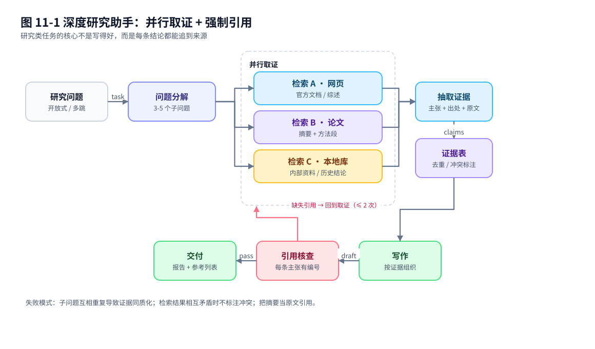

# 11 · 案例 A：深度研究助手

> 研究类任务的验收标准只有一条：每条结论都能回到一段原文。本章把前七章的能力装成一条可交付的流水线。

## 11.1 需求拆解

输入是一句开放式问题，例如"过去两年，检索增强在企业知识库场景的主要失败模式有哪些？"，输出是一份带引用的简报。五项验收标准各有一套机制支撑，缺一项就会在某个环节暴露。

| 要求 | 含义 | 对应机制 |
|---|---|---|
| 多源 | 至少三个独立来源 | 并行检索 |
| 可核验 | 每条结论有编号引用 | 证据表 + 引用核查 |
| 可追溯 | 能回到原文段落 | 块 id 与来源元数据 |
| 有边界 | 资料不足时明说 | 覆盖率阈值 + 显式声明 |
| 可复现 | 同一输入可重跑 | 固定检索参数 + 轨迹 |



*图 11-1　分解 → 并行取证 → 证据表 → 写作 → 引用核查。红色回路是"缺引用就回去补检索"，最多两次。*

## 11.2 五个阶段

五个阶段依次是问题分解、并行取证、证据表、写作与引用核查，前两个阶段产出候选材料，后三个把材料变成简报。

分解把大问题拆成 3—5 个子问题，每个子问题对应一次检索。子问题互相重复会让证据同质化，拆得过细又检索不到，整条流水线的上限在这一步定下。

```python
plan = Planner().from_template([
    "RAG 在知识库场景的典型失败模式",
    "失败模式的成因分类",
    "业界的缓解手段与效果证据",
])
```

并行取证让每个子问题各走一条检索链路，网页、论文与本地库分别记录来源类型。并行压缩的是延迟，代价是结果需要去重。

```python
hits = {q: pipeline.retrieve(q, k=4) for q in sub_questions}
```

证据表是最关键的结构，每条证据记下主张、原文片段、来源 id、发布时间与可信度；片段不超过 200 字，可信度取 0 到 1，由来源类型与多源一致性决定。

```python
@dataclass
class Evidence:
    claim: str          # 一句话主张
    quote: str          # 原文片段（≤ 200 字）
    source_id: str      # 块 id，可回溯
    published: str      # 发布时间
    confidence: float   # 0-1，由来源类型与一致性决定
```

有了证据表，写作就变成选证据与组织语言，引用成为结构约束，不必等到成稿再补标。段落按证据组织，每段先给结论再给支撑，证据表之外的事实一律不许引入。这条规则要写进系统提示，并在核查阶段逐条验证。

引用核查逐句追问三件事：这句话有编号吗，编号落在候选范围内吗，编号对应的原文是否真的支持它。前两项可以规则化，第三项要靠模型判断或者人工抽查。

```python
coverage = citation_coverage(draft, hits)
if coverage < 0.8:
    return re_retrieve(missing_claims)   # 最多两次
```

## 11.3 冲突处理

多源研究必然遇到相互矛盾的资料，例如两个版本的行业报告，或者两篇结论相反的论文。处理方式有三种，可靠性依次下降。并列呈现写明"来源 A 认为……，来源 B 认为……，差异可能源于样本不同"，这是最诚实的做法。按可信度加权先给来源打分，官方文档高于同行评议，同行评议高于博客，采纳高分来源并注明理由。按时间取新只适用于价格、政策这类事实随时间变化的场景，学术争论不能这样处理。最差的做法是让模型"综合一下"，生成一段看不出矛盾的平滑叙述。

## 11.4 失败模式与对策

| 失败 | 表现 | 对策 |
|---|---|---|
| 证据同质化 | 五个来源其实是同一篇的转载 | 按域名/作者去重，强制多源类型 |
| 引用错位 | [2] 指向无关段落 | 编号校验 + 逐句核对 |
| 过度概括 | 把"某案例"写成"普遍规律" | 证据强度分级，弱证据加限定词 |
| 检索漂移 | 子问题越查越偏 | 每个子问题设"相关性闸门" |
| 长度失控 | 八千字报告，信息密度低 | 先出提纲，按提纲配额写作 |

## 11.5 评估这套系统

| 指标 | 目标 | 采集 |
|---|---|---|
| 引用覆盖率 | ≥ 0.8 | 自动 |
| 证据可回溯率 | 100% | 抽查 source_id 是否存在 |
| 冲突标注率 | 有冲突必标注 | 构造含冲突的用例 |
| 单份报告成本 | ≤ 基线 120% | 轨迹统计 |
| 人工可用率 | ≥ 70% 可直接交付 | 抽样评分 |

"人工可用率"是最重要的业务指标，也最容易被忽略：一份引用齐全但结构混乱的报告，仍然需要人重写。

## 11.6 可以怎么扩展

扩展有三个方向。每条证据记下发布时间，写作按时间线组织，报告就有了时间维度；让一个角色专门找"证据不支持结论"的地方，可以借用第 08 章的辩论结构；把证据表落盘，下次只检索新增部分，增量更新的成本会低很多。

## 练习

1. 把 `RAGPipeline` 与 `PlanAndExecute` 组合成上述五阶段，先用 3 个本地文档跑通。
2. 构造一组"资料相互矛盾"的文档，验证系统会并列呈现而不是强行综合。
3. 给引用核查加一条规则：同一编号被引用超过 3 次时告警（可能是过度依赖单一来源）。

## 参考

- 代码：`learning_agents/rag.py`、`learning_agents/planning.py`、`learning_agents/reflection.py`
