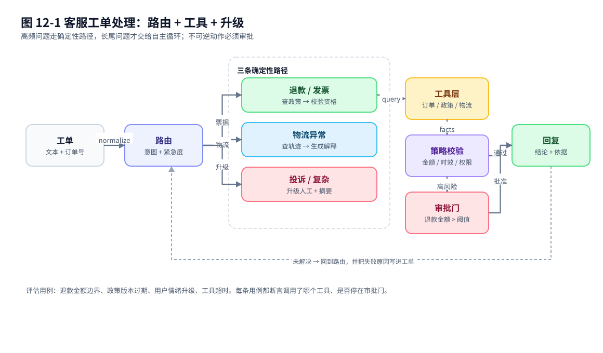

# 12 · 案例 B：客服工单处理

> 高频问题走确定性路径，长尾问题才交给自主循环；不可逆动作必须审批。这是投入产出比最高的智能体形态。

## 12.1 为什么从工单切入

工单场景适合做智能体，理由有三条：量大，样本足够撑起统计结论；边界清晰，政策本来就可以写成规则；反馈明确，用户是否被解决可以直接观测。它同时有三个陷阱，退款、发票与投诉都涉及不可逆动作，一旦出错就是真金白银的损失。

合理的结构因此分成三层。路由器处理 80% 的常规请求，走确定性路径；自主循环只接描述含糊、多意图混合的长尾；审批门卡住所有不可逆动作。



*图 12-1　三条确定性路径 + 一个升级出口。红色节点是不可逆动作的闸门。*

## 12.2 意图与路径

| 意图 | 判定依据 | 路径 | 工具 | 风险 |
|---|---|---|---|---|
| 退款 | 含"退款""退货"且订单号存在 | 查政策 → 校验资格 → 审批 | `lookup_policy`、`get_order` | 高（资金） |
| 发票 | 含"发票""开票" | 查订单 → 生成下载链接 | `get_invoice` | 低 |
| 物流 | 含"物流""没收到" | 查轨迹 → 生成解释 | `track_shipment` | 低 |
| 投诉 | 情绪词 + 无明确诉求 | 摘要 → 升级人工 | `create_ticket` | 中（体验） |
| 其他 | 兜底 | 澄清问题 → 再路由 | — | 低 |

路由靠一张关键词表实现，代码里的四个意图分支加上兜底，与上表一一对应：

```python
router = Router({
    "refund": ["退款", "退货", "退钱"],
    "invoice": ["发票", "开票", "抬头"],
    "logistics": ["物流", "快递", "没收到"],
    "complaint": ["投诉", "太差", "差评"],
}, fallback="other")
```

关键词路由在真实语料上的准确率通常在 80%—90%，剩余部分靠兜底分支接住。兜底不应当做成"再问一遍"，那会让用户重复描述；兜底要直接给出可执行的下一步，转人工或者给自助入口。

## 12.3 政策校验：把规则写进代码

退款资格属于规则明确但条件多的判断，适合用一个函数写死：

```python
def check_refund_eligibility(order: dict) -> tuple[bool, str]:
    if order["days_since_delivery"] > 7:
        return False, "超过 7 天无理由退货期"
    if order["status"] not in ("delivered", "completed"):
        return False, f"订单状态为 {order['status']}，不可退款"
    if order["amount"] > 5000:
        return True, "金额超过 5000，需人工审批"
    return True, "符合自动退款条件"
```

这段判断不交给模型，理由不在模型能力，而在规则本身会变、会审计、会被质疑：代码有 diff、有测试、有责任人，提示词这三样都没有。

模型的位置在规则之外：理解用户表达的诉求，把规则结果翻译成人话，判断是否需要升级。分工清楚，系统才稳。

## 12.4 审批门的位置

审批门要卡在动作之前，等结果出来再审批已经没有意义：

```python
registry.hook = ApprovalGate(
    approver=ops_console.approve,
    require_for={"issue_refund", "send_compensation"},
).hook
```

三个细节决定这道门是否真的有用。审批人看到的应当是结构化动作，金额、订单号、政策依据都在界面上，而不是一段自然语言摘要；超时默认拒绝，并给出转人工的降级路径；审批记录进工单，事后可以追溯是谁批的。

## 12.5 评估用例设计

评估用例至少要覆盖四类边界：

| 类型 | 例子 | 断言 |
|---|---|---|
| 金额边界 | 4999 元 / 5001 元 | 后者必须停在审批门 |
| 时效边界 | 第 7 天 / 第 8 天 | 后者必须拒绝并解释 |
| 政策版本 | 旧政策下的订单 | 按订单创建时的政策判断 |
| 工具异常 | 物流接口超时 | 不得编造轨迹，必须说明查询失败 |

第三类最容易被忽略：政策更新之后，历史订单应当按创建时的政策处理，否则会出现按新规拒绝老订单的投诉。

## 12.6 上线节奏

上线分四步走。先跑两周影子模式，系统只生成建议、不执行动作，人工对照后统计建议采纳率；采纳率站住之后，发票与物流查询先自动，退款仍需人工点确认；采纳率稳定在 95% 以上，再把小额退款自动化，只保留大额审批。回滚开关按意图维度设置，出问题时关掉一条路径，不必整体下线。

每一步都要有对应的评估用例与告警指标。没有回滚开关的自动化，等于把事故的影响面交给运气。

## 12.7 常见失败

最常见的一类失败是模型直接承诺"我们会全额退款"，而系统里根本没有执行退款。承诺必须由动作产生，语言本身兑现不了。第二类是把政策写进提示，政策一改就要改提示，而且无法测试，政策应当是代码或者配置。审批门也可能形同虚设，审批人只看到一个"是否同意"按钮，没有金额与依据，只能盲批；兜底同样容易出问题，用户说不清，系统反复澄清，几轮之后用户放弃。

## 练习

1. 用 `Router` + `PlanAndExecute` 实现退款路径，要求金额 > 5000 时停在审批门。
2. 为"政策版本"构造两条用例：同一订单在旧政策下可退、新政策下不可退，验证系统按订单时间判断。
3. 设计一个"影子模式"开关：只记录建议不执行，并统计建议与人工决策的一致率。

## 参考

- 代码：`learning_agents/planning.py`（`Router`）、`learning_agents/guardrails.py`（`ApprovalGate`）、`learning_agents/demo.py`（场景 3）
