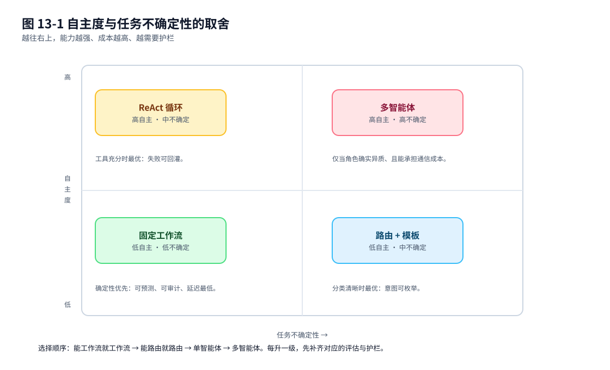
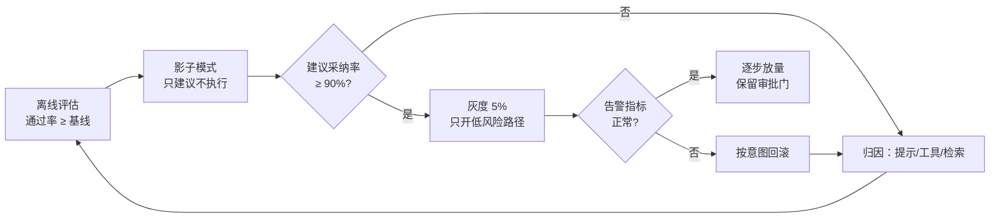

# 13 · 从原型到产品：清单与反模式

> 原型证明"能做"，产品要证明"稳定地做、便宜地做、出错能兜住"。

## 13.1 发布前的十二条清单

*图 13-1　清单的长度与系统的自主度成正比：越靠右上，需要补的护栏越多。*

| # | 检查项 | 不合格的表现 | 对应章节 |
|---|---|---|---|
| 1 | 每个循环都有四条终止条件 | 偶发任务跑 10 分钟不结束 | 01 |
| 2 | 上下文有预算表 | 长会话后期答非所问 | 02 |
| 3 | 工具 schema 有描述与副作用标记 | 模型误调写操作 | 03 |
| 4 | 错误带可行动前缀 | 模型反复重试同一个错误 | 03 |
| 5 | 记忆有阈值、TTL、租户隔离 | 串味、过时答案 | 04 |
| 6 | 高风险流程走确定性路径 | 退款路径每次都不一样 | 05、12 |
| 7 | 反思有轮数上限与回退 | 改到最后一版最差 | 06 |
| 8 | 检索有引用校验 | 引用编号指向无关段落 | 07 |
| 9 | 多智能体有仲裁与预算 | 角色互相客气，无人拍板 | 08 |
| 10 | 关键步骤有检查点 | 进程重启后从零开始 | 09 |
| 11 | 有三层评估与门禁 | 每次发版靠手感 | 10 |
| 12 | 有回滚开关 | 出问题只能整体下线 | 12 |

十二条里任何一条缺失，都足以让一次"成功的内测"变成失败的公测。表中每项都能在正文里找到对应的机制，末列标出回查的章节。

## 13.2 发布流程

流程本身并不复杂，起作用的是每一步的进入条件与退出条件，而且这些条件必须可量化。"灰度观察一周"不算条件，"P95 时延 < 3s 且投诉率不升"才算。

## 13.3 成本工程

智能体的成本有三个乘数：步数、上下文长度、调用次数，对应的杠杆与风险如下表。

| 杠杆 | 做法 | 风险 |
|---|---|---|
| 降步数 | 路由替代循环、缩小 max_steps | 复杂任务被截断 |
| 降上下文 | 摘要、检索替代全量、精简工具描述 | 丢关键信息 |
| 降次数 | 缓存、批处理、小模型分流 | 缓存不一致 |

一个实用的做法是按任务分层用模型，路由与抽取交给小模型，规划与写作交给大模型。分层之后总成本通常能降 40%—70%，端到端质量下降有限，前提是每一层都有评估。

另一个常被忽略的成本项是失败重试：一次失败任务可能消耗掉三次成功任务的预算。把 `stopped_reason` 纳入成本报表，才能看到成本的真实分布。

## 13.4 反模式清单

架构上最常见的四种错误是：用多智能体去解决提示没写好，用自主循环处理本该写死的流程，把政策、权限、金额阈值写进提示词，在没有评估集的情况下比较两个方案。实现层面的错误更琐碎，也更难在评审时发现：工具里 `except: pass`，截断工具输出却不标注，每次请求重建全部消息把状态丢掉，状态里放不可序列化的对象。运营层面的错误通常要等事故才暴露：只监控成功率而不看 `stopped_reason` 分布，没有按意图的回滚开关，上线后不再更新用例集，把"用户没投诉"当成质量指标。

## 13.5 团队与职责

一个能持续迭代的智能体项目需要三种角色，不必是三个人。

| 角色 | 关注 | 产出 |
|---|---|---|
| 产品 | 任务边界、验收标准 | 用例集、评分 rubric |
| 工程 | 循环、工具、编排、可观测 | 可运行系统、轨迹、门禁 |
| 领域专家 | 政策、话术、例外 | 规则、边界案例、人工审核 |

最常见的组织问题是领域专家缺位：规则由工程师猜，例外由模型编，出了事靠客诉补齐。

## 13.6 如何继续学习

本库覆盖的是机制层面，继续深入可以按下面的顺序读上游的 65 篇教程（完整映射见[附录 B](B-upstream-map.md)）：

1. 先用 `agent_while_loop_from_scratch`、`reflection_from_scratch`、`plan_then_execute_from_scratch` 三个 notebook 对照本库第 01、06、05 章，看同一机制在不同抽象层的写法；
2. 再用 `memory-agent-tutorial`、`context_engineering_from_scratch` 深入记忆与上下文；
3. 然后用 `langgraph-tutorial`、`human_in_the_loop_approval_agent`、`trace_based_agent_evaluation` 补齐编排与评估；
4. 挑一个与自己业务最接近的行业案例（客服、HR、合同、文档入库），只读它的状态设计与工具层，跳过 UI 与数据准备。

读教程时的三个提问比读懂代码更重要：它的终止条件是什么？失败时模型看到什么？这套设计在什么条件下会失效？

## 13.7 结语

智能体的工程化说到底落在三件事上：把不确定性关进循环，把循环关进预算，把预算关进评估。模型会继续变强，框架会继续更替，这三件事的次序不会变。

## 参考

- 代码：全仓库；`tests/` 是本文清单的可执行版本。
